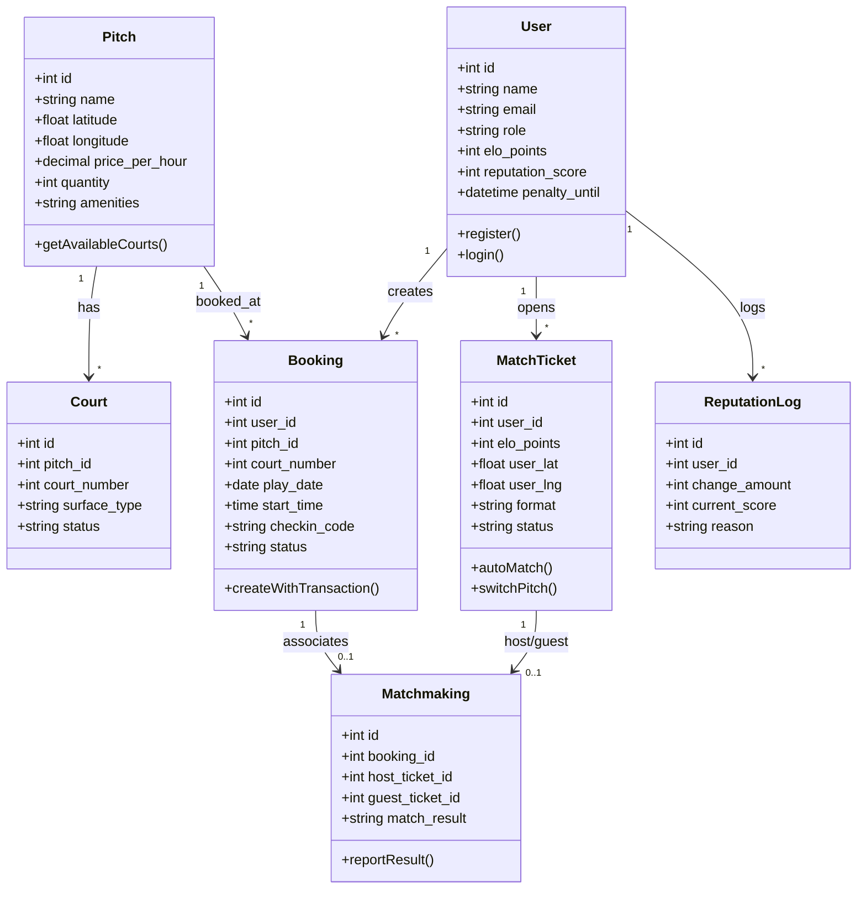
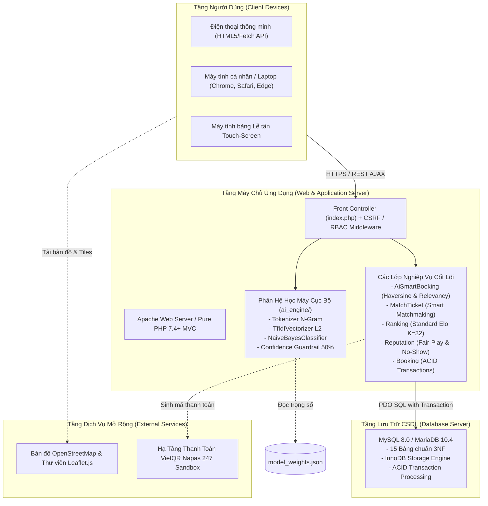
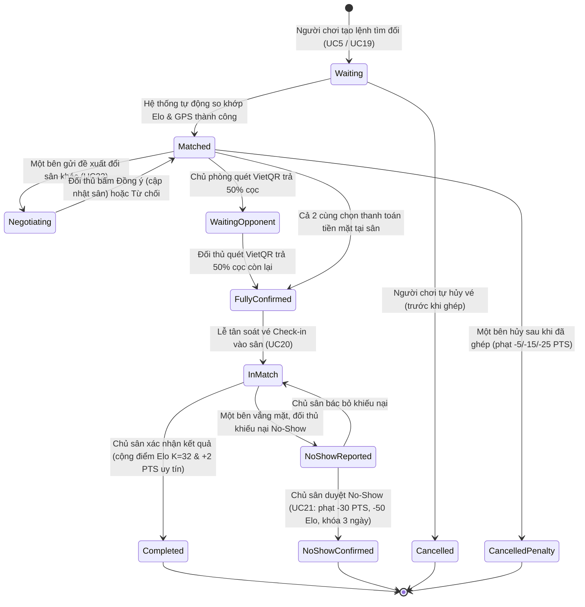
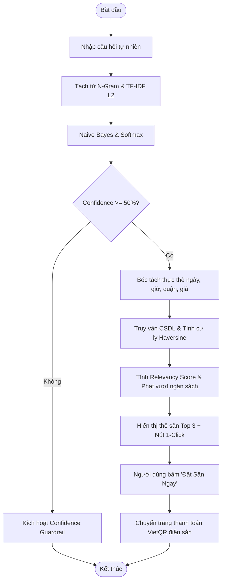
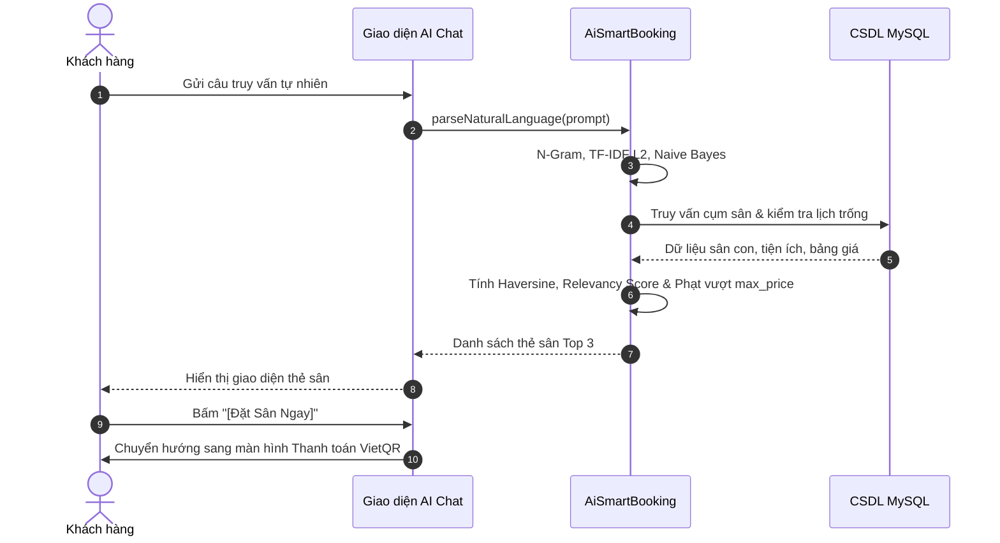

# BÁO CÁO KHÓA LUẬN TỐT NGHIỆP TOÀN DIỆN (BẢN HỢP NHẤT HOÀN CHỈNH)

**ĐỀ TÀI:** XÂY DỰNG HỆ THỐNG ĐẶT SÂN CẦU LÔNG TRỰC TUYẾN SMASHHUB HỖ TRỢ GỢI Ý GHÉP SÂN THÔNG MINH  
**CHUYÊN NGÀNH:** CÔNG NGHỆ THÔNG TIN / KỸ THUẬT PHẦN MỀM  
**HỆ ĐÀO TẠO:** ĐẠI HỌC CHÍNH QUY  

---

> ### HƯỚNG DẪN SỬ DỤNG NHANH TỆP TỔNG HỢP
> Tệp tài liệu này đã được hợp nhất toàn diện từ tất cả các nội dung nghiên cứu, thiết kế kiến trúc, mã nguồn và số liệu thực nghiệm khoa học thực tế của dự án. Tài liệu được cấu trúc thành 2 phần rõ ràng để bạn thao tác vào Google Docs:
> - **PHẦN I (Trang 2 – 15):** Toàn bộ các đoạn văn bản, công thức toán học, mô hình UML và bảng đặc tả cần **bổ sung / cập nhật vào Chương 1, Chương 2 và Chương 3** của tệp báo cáo hiện tại.
> - **PHẦN II (Trang 16 – 40):** Toàn văn **Chương 4, Chương 5, Danh mục Tài liệu tham khảo và Phụ lục** để bạn **dán nối tiếp ngay sau Mục 3.5.16** của tệp báo cáo hiện tại.

---

# PHẦN I: NỘI DUNG CẬP NHẬT VÀ BỔ SUNG CHO CHƯƠNG 1, 2 VÀ 3

---

## 1. CẬP NHẬT CHƯƠNG 1 (TỔNG QUAN ĐỀ TÀI)

### 1.1. Bổ sung vào Mục 1.2: Mục tiêu của đề tài
*(Chèn thêm mục tiêu nghiên cứu AI vào sau mục tiêu số 3 trong báo cáo)*
- **Nghiên cứu, tự xây dựng và tích hợp Động cơ Trí tuệ Nhân tạo Xử lý Ngôn ngữ Tự nhiên (NLP In-House Engine):** Xây dựng mô hình học máy phân loại ý định (Intent Classification) và bóc tách thực thể (Entity Extraction) tiếng Việt hoạt động độc lập trên máy chủ cục bộ (On-Premise). Cho phép người dùng tìm kiếm sân và giữ chỗ bằng câu hội thoại tự nhiên (ví dụ: *"Tìm sân ở Bình Thạnh chiều nay 17h thảm BWF giá dưới 85k"*), tự động lượng hóa mức độ liên quan đa mục tiêu (vị trí GPS, giá tiền, số sân trống, tiện ích) để gợi ý sân tối ưu nhất chỉ với 1 thao tác bấm chuột (1-Click Booking).

### 1.2. Bổ sung vào Mục 1.3: Yêu cầu ban đầu của đề tài
*(Cập nhật hệ thống phân quyền và tính năng AI đàm thoại)*
- **Chuẩn hóa Hệ thống 4 Phân quyền Người dùng (RBAC):** Hệ thống thiết kế độc lập 4 nhóm tác nhân chuyên biệt gồm: **Khách hàng (`user`)**, **Chủ sân (`owner`)**, **Nhân viên Lễ tân (`staff`)** và **Quản trị viên (`admin`)**. Trong đó, Lễ tân được trang bị bàn trực cảm ứng Touch-friendly để soát vé Check-in 1-Click bằng Barcode / Mã số độc lập cho 2 bên trong các kèo ghép AI.
- **Tích hợp Trợ lý Ảo AI Đặt Sân Thông Minh (AI Smart Booking Copilot):** Hệ thống không chỉ dừng lại ở các bộ lọc tìm kiếm truyền thống mà trang bị cửa sổ chat thông minh. Trợ lý AI có khả năng hiểu ngữ cảnh thời gian (hôm nay, ngày mai, cuối tuần, tối nay), nhận diện địa bàn quận/huyện, kiểm soát ngân sách tối đa của khách hàng, đồng thời tích hợp cơ chế bảo vệ ngưỡng tin cậy (Confidence Guardrail $\ge 50\%$) để từ chối các câu hỏi ngoài phạm vi thể thao, định hướng người dùng vào các dịch vụ chuyên môn.

### 1.3. Bổ sung vào Mục 1.6: Đề xuất giải pháp
- **Giải pháp Đặt Sân Ngôn Ngữ Tự Nhiên (Natural Language Booking):** Thay vì bắt buộc khách hàng phải qua nhiều bước lọc thủ công phức tạp (chọn tỉnh/thành, chọn quận, chọn khung giờ, so sánh giá từng sân), SMASHHUB đề xuất giải pháp tiếp cận đàm thoại trực quan. Người dùng chỉ cần gửi yêu cầu bằng ngôn ngữ tự nhiên, hệ thống sẽ tự động chuyển hóa thành vector đặc trưng, bóc tách thực thể và xếp hạng độ liên quan Relevancy Score trong vòng dưới 1.5 giây.

---

## 2. BỔ SUNG TRỌN VẸN MỤC 2.2 VÀO CHƯƠNG 2 (CƠ SỞ NGHIÊN CỨU LÝ THUYẾT)

*(Chèn thêm Mục 2.2 mới vào giữa Mục 2.1 Ghép sân thông minh và Mục 2.3 Mô hình MVC/PHP)*

### 2.2. Cơ sở lý thuyết về Xử lý Ngôn ngữ Tự nhiên (NLP) và Học máy Phân loại Ý định

Nhằm xây dựng Trợ lý ảo AI đặt sân và tư vấn chuyên môn hoạt động độc lập không phụ thuộc vào các dịch vụ đám mây trả phí, đề tài đi sâu nghiên cứu và ứng dụng các kỹ thuật xử lý ngôn ngữ tự nhiên tiếng Việt kết hợp cùng thuật toán học máy phân loại xác suất.

#### 2.2.1. Kỹ thuật Tách từ và Tổ hợp N-Gram tiếng Việt
Khác với tiếng Anh (các từ đơn cách nhau bằng dấu khoảng trắng), tiếng Việt là ngôn ngữ đơn lập, ranh giới từ phức tạp với nhiều từ ghép mang ý nghĩa chuyên biệt (ví dụ: *"sân cầu lông"*, *"thảm tiêu chuẩn"*, *"bãi đỗ xe"*). Do đó, việc chỉ tách từ đơn (Unigram) sẽ làm phân mảnh ngữ nghĩa.  
Đề tài ứng dụng kỹ thuật tạo đặc trưng tổ hợp N-Gram (kết hợp Unigram và Bigram liền kề):
- Giả sử câu văn gồm chuỗi các từ $W = \{w_1, w_2, \dots, w_m\}$.
- Tập đặc trưng N-Gram bậc 2 được sinh ra theo quy tắc:
  $$\text{N-Gram}(W) = \{w_i\}_{i=1}^m \cup \{w_i w_{i+1}\}_{i=1}^{m-1}$$
Ví dụ: Câu *"tìm sân Bình Thạnh"* sẽ được phân tích thành tập từ tố: `['tìm', 'sân', 'bình', 'thạnh', 'tìm sân', 'sân bình', 'bình thạnh']`. Điều này giúp mô hình nắm bắt chính xác các thực thể địa danh và ý định hành động của người dùng.

#### 2.2.2. Mô hình Không gian Vector TF-IDF Chuẩn hóa $L_2$
Để chuyển đổi văn bản từ dạng ký tự sang dạng vector số học phục vụ cho các thuật toán học máy, đề tài sử dụng phương pháp tần suất từ - nghịch đảo tần suất văn bản (Term Frequency - Inverse Document Frequency - TF-IDF):
1. **Tần suất xuất hiện của từ (Term Frequency - TF):** Đo lường mức độ xuất hiện của từ $t$ trong câu truy vấn $d$:
   $$\text{TF}(t, d) = \frac{f_{t, d}}{\sum_{t' \in d} f_{t', d}}$$
2. **Nghịch đảo tần suất văn bản (Inverse Document Frequency - IDF):** Đánh giá mức độ quan trọng và tính đặc trưng của từ $t$ trên toàn bộ tập dữ liệu huấn luyện gồm $N$ mẫu câu:
   $$\text{IDF}(t) = \ln\left(1 + \frac{N}{1 + \text{DF}(t)}\right)$$
   Trong đó $\text{DF}(t)$ là số lượng mẫu câu có chứa từ $t$. Công thức cộng $1$ ở mẫu số nhằm tránh lỗi chia cho 0 khi gặp từ vựng mới (Smooth IDF).
3. **Trọng số TF-IDF và Chuẩn hóa Euclid ($L_2$ Normalization):**
   $$\text{TF-IDF}(t, d) = \text{TF}(t, d) \times \text{IDF}(t)$$
   Vector đặc trưng $\mathbf{v}_d$ của câu $d$ được chuẩn hóa độ dài về mặt cầu đơn vị theo chuẩn $L_2$:
   $$\mathbf{v}'_d = \frac{\mathbf{v}_d}{\|\mathbf{v}_d\|_2} = \frac{\mathbf{v}_d}{\sqrt{\sum_{t} \text{TF-IDF}(t, d)^2}}$$
Việc chuẩn hóa $L_2$ giúp triệt tiêu hoàn toàn sự chênh lệch do độ dài ngắn khác nhau giữa các câu hỏi của người dùng.

#### 2.2.3. Thuật toán Phân loại Xác suất Đa thức Naive Bayes (Multinomial Naive Bayes)
Multinomial Naive Bayes là một trong những mô hình học máy phân loại văn bản hiệu quả nhất với chi phí tính toán thấp, tốc độ suy luận dưới 2ms và hoạt động bền bỉ trên tập dữ liệu mẫu quy mô vừa. Dựa trên Định lý Xác suất Bayes và giả định độc lập có điều kiện giữa các đặc trưng từ vựng:
$$P(c | d) = \frac{P(c) P(d | c)}{P(d)} \propto P(c) \prod_{i=1}^V P(w_i | c)^{f_{i, d}}$$
Trong đó:
- $c \in C$: Nhóm ý định cần dự đoán ($|C| = 10$ nhóm ý định thể thao).
- $P(c)$: Xác suất tiên nghiệm của lớp $c$, được ước lượng bằng tỷ lệ mẫu: $P(c) = \frac{N_c}{N}$.
- $P(w_i | c)$: Xác suất có điều kiện của từ vựng $w_i$ xuất hiện trong lớp $c$.

Để xử lý hiện tượng "xác suất bằng 0" (khi một từ vựng chưa từng xuất hiện trong lớp ý định $c$ ở tập huấn luyện, làm triệt tiêu toàn bộ tích xác suất về 0), đề tài áp dụng **Kỹ thuật làm mịn Laplace (Laplace Smoothing)** với tham số $\alpha = 0.1$:
$$P(w_i | c) = \frac{N_{c, w_i} + \alpha}{\sum_{w \in V} N_{c, w} + \alpha |V|}$$
Trong đó $N_{c, w_i}$ là tổng số lần từ $w_i$ xuất hiện trong lớp $c$, và $|V|$ là kích thước toàn bộ không gian từ vựng của hệ thống.

#### 2.2.4. Hàm Chuẩn hóa Xác suất Softmax và Ngưỡng Tin Cậy (Confidence Guardrail)
Để chuyển đổi các giá trị Log-Likelihood không chuẩn hóa $\log P(c|d)$ thành phân phối xác suất hợp lệ có tổng bằng 1, hệ thống áp dụng hàm Softmax:
$$\text{Confidence}(c) = \frac{e^{\log P(c|d) - \max_k \log P(k|d)}}{\sum_{j \in C} e^{\log P(j|d) - \max_k \log P(k|d)}}$$

**Cơ chế Ngưỡng Tin Cậy Bảo Vệ (Confidence Guardrail):**  
Trong các hệ thống AI ứng dụng thực tế, người dùng có xu hướng thử nghiệm các câu hỏi phi thể thao (chính trị, nấu ăn, toán học, đời sống). Nếu không có cơ chế chặn, mô hình vẫn sẽ cố gắng gán câu hỏi đó vào 1 trong 10 lớp ý định với nhãn có điểm số cao nhất (hiện tượng đoán mò gây ảo giác).  
Hệ thống thiết lập một ngưỡng tin cậy bảo vệ:
$$\text{Decision} = \begin{cases} 
\text{Phản hồi Ý định } c^*, & \text{nếu } \max_{c} \text{Confidence}(c) \ge 0.50 \\
\text{Kích hoạt Bộ lọc Ngoài phạm vi (Out-of-Scope)}, & \text{nếu } \max_{c} \text{Confidence}(c) < 0.50
\end{cases}$$
Khi rơi vào trường hợp ngoài phạm vi, Trợ lý AI sẽ lịch sự từ chối và hiển thị thực đơn hướng dẫn người dùng quay lại 4 lĩnh vực chuyên môn: Đặt sân, Tìm đối thủ, Luật BWF và Tư vấn thiết bị.

---

## 3. CẬP NHẬT VÀ BỔ SUNG CHO CHƯƠNG 3 (PHÂN TÍCH VÀ THIẾT KẾ HỆ THỐNG)

### 3.1. Bổ sung Quy trình nghiệp vụ 3.2.4 (Mục 3.2)
#### 3.2.4. Quy trình nghiệp vụ Đặt sân thông minh bằng Trợ lý Ảo AI (AI Smart Booking)
- **Bước 1:** Khách hàng mở cửa sổ Trợ lý AI và nhập nhu cầu bằng ngôn ngữ tự nhiên (ví dụ: *"Đặt sân ở Gò Vấp tối mai 19h có máy lạnh dưới 90k"*).
- **Bước 2:** Bộ phân tích ngôn ngữ tự nhiên `AiSmartBooking` bóc tách các thực thể: Ngày (`date`), Khung giờ (`start_time`), Địa bàn (`district`), Ngân sách tối đa (`max_price`), Tiện ích (`amenities`).
- **Bước 3:** Hệ thống quét CSDL các cụm sân, truy vấn số sân con còn trống tại khung giờ yêu cầu, tính khoảng cách Haversine và tính điểm đa mục tiêu Relevancy Score. Áp dụng mức phạt giảm điểm nếu giá sân vượt quá ngân sách.
- **Bước 4:** Trợ lý AI phản hồi trực quan danh sách Top 3 cụm sân thỏa mãn nhất kèm thông tin giá tiền, cự ly và tiện ích.
- **Bước 5:** Khách hàng chỉ cần bấm nút `[🎯 Đặt Sân Ngay (1-Click)]` trên thẻ sân được AI gợi ý để được chuyển thẳng đến cổng thanh toán VietQR với toàn bộ thông số đã được điền sẵn chính xác.

### 3.2. Cập nhật Danh mục Yêu cầu chức năng (Mục 3.3.1)
Bổ sung thêm 6 yêu cầu chức năng mới vào bảng yêu cầu:
- **FR17 - Trò chuyện và Tư vấn qua Trợ lý Ảo AI:** Cung cấp giao diện hội thoại thời gian thực, nhận diện 10 nhóm ý định cầu lông và trả lời các thắc mắc chuyên môn (chọn vợt 3U/4U, cước, luật phát cầu 1m15, chia tiền 50/50).
- **FR18 - Đặt sân bằng ngôn ngữ tự nhiên (Natural Language Booking):** Tự động bóc tách thực thể ngày, giờ, quận huyện, khoảng giá và tiện ích từ câu chat của người dùng để đề xuất sân trống phù hợp nhất mà không cần qua form lọc thủ công.
- **FR19 - Mở lệnh tìm đối thủ 1-Click bằng AI:** Khi người dùng chat tìm bạn đánh cầu, AI tự động quét CSDL tìm đối thủ đang chờ kèo tương đồng Elo & GPS để hiển thị nút kết nối ngay; nếu chưa có ai, AI tự động chuẩn bị sẵn thông số vé tìm đối để người dùng mở lệnh chỉ với 1 click.
- **FR20 - Soát vé Check-in Touch-Friendly cho Lễ tân:** Trang bị bàn trực cảm ứng cho Lễ tân, cho phép check-in bằng Barcode / Mã 6 ký tự độc lập từng người trong kèo 50/50.
- **FR21 - Trọng tài xử lý khiếu nại Bùng kèo No-Show:** Cho phép Chủ sân xem xét khiếu nại của người chơi, bấm *"Xác Nhận Bùng Kèo"* (trừ 30 Uy Tín, -50 Elo, khóa 3 ngày) hoặc *"Bác Bỏ Khiếu Nại"*.
- **FR22 - Đề xuất và Đàm phán đổi sân thời gian thực:** Cho phép 2 cơ thủ trong phòng ghép 50/50 gửi đề xuất đổi sang cụm sân trung tâm khác và xác nhận đồng thuận qua cơ chế Zero-Reload.

---

### 3.3. Cập nhật Sơ đồ Use Case Tổng Quát (Mục 3.4)

```mermaid
flowchart TD
    subgraph Actors ["Các Tác Nhân Hệ Thống (4 Roles)"]
        User((Khách hàng))
        Owner((Chủ sân))
        Staff((Nhân viên Lễ tân))
        Admin((Quản trị viên))
    end

    subgraph UserUC ["Phân Hệ Khách Hàng & Trợ Lý AI"]
        UC3([UC3: Tra cứu & Tìm kiếm sân])
        UC4([UC4: Đặt sân & Thanh toán VietQR])
        UC5([UC5: Gợi ý ghép sân thông minh])
        UC6([UC6: Phòng ghép sân & Xác nhận 50/50])
        UC17([UC17: Đặt sân thông minh NLP 1-Click])
        UC18([UC18: Tư vấn chuyên môn & Luật BWF])
        UC19([UC19: Mở lệnh tìm đối 1-Click qua AI])
        UC22([UC22: Đề xuất & Đàm phán đổi sân])
    end

    subgraph OwnerStaffUC ["Phân Hệ Vận Hành & Quản Lý Cụm Sân"]
        UC10([UC10: Quản lý đơn đặt sân])
        UC11([UC11: Lịch lưới Court Schedule Grid])
        UC12([UC12: Cập nhật kết quả thi đấu Elo])
        UC13([UC13: Quản lý sân con & Bảng giá])
        UC20([UC20: Bàn trực Lễ tân & Check-in Touch])
        UC21([UC21: Trọng tài phân xử bùng kèo No-Show])
        UC16([UC16: Thống kê doanh thu Chart.js])
    end

    subgraph AdminUC ["Phân Hệ Quản Trị Hệ Thống"]
        UC14([UC14: Quản lý cụm sân & Duyệt nội dung])
        UC15([UC15: Quản lý tài khoản, Cấp quyền & Uy tín])
    end

    User --> UC3
    User --> UC4
    User --> UC5
    User --> UC6
    User --> UC17
    User --> UC18
    User --> UC19
    User --> UC22

    Owner --> UC10
    Owner --> UC11
    Owner --> UC12
    Owner --> UC13
    Owner --> UC21
    Owner --> UC16

    Staff --> UC20
    Staff --> UC11

    Admin --> UC14
    Admin --> UC15
    Admin --> UC16

    UC17 -.->|<<extend>>| UC3
    UC17 -.->|<<include>>| UC4
    UC19 -.->|<<include>>| UC5
```

---

### 3.4. Bổ sung các Sơ đồ Thiết kế Kiến trúc Nâng cao

#### A. Sơ đồ Lớp Khái niệm (Domain Class Diagram)

#### B. Sơ đồ Kiến trúc Triển khai (Deployment Diagram)

#### C. Sơ đồ Trạng thái Vòng đời Vé Ghép Trận (State Machine Diagram)

---

### 3.5. Bổ sung Đặc tả Chi tiết 6 Use Case Mới vào Mục 3.5

#### 3.5.17. Use Case Đặt sân thông minh & Tư vấn qua Trợ lý AI (UC17 & UC18)
- **Tên use case:** Đặt sân thông minh & Tư vấn qua Trợ lý AI
- **Actor chính:** Khách hàng (`user`), Phân hệ Học máy NLP (`ai_engine`).
- **Mô tả sơ lược:** Cho phép Khách hàng tương tác bằng ngôn ngữ tự nhiên để tra cứu sân trống, nhận gợi ý cụm sân tối ưu theo cự ly, ngân sách và tiện ích, sau đó thực hiện đặt sân 1-Click hoặc nhận tư vấn chuyên môn cầu lông.
- **Tiền điều kiện:** Người dùng truy cập vào website SMASHHUB.
- **Hậu điều kiện:** Hệ thống bóc tách thực thể chính xác, xếp hạng Relevancy Score và hiển thị danh sách thẻ sân kèm nút Đặt Sân Ngay 1-Click.
- **Luồng sự kiện chính (Main Flow):**
  1. *Actor:* Mở cửa sổ Trợ lý AI ở góc màn hình.
  2. *Actor:* Nhập câu yêu cầu bằng ngôn ngữ tự nhiên (ví dụ: *"Tìm sân ở Bình Thạnh chiều nay 17h thảm BWF giá dưới 85k"*).
  3. *System:* Tiền xử lý N-Gram, biến đổi TF-IDF $L_2$ và phân loại ý định qua Naive Bayes.
  4. *System:* Kiểm tra ngưỡng tin cậy $Confidence \ge 0.50$.
  5. *System:* Bóc tách các thực thể: ngày, khung giờ, quận/huyện, ngân sách tối đa và tiện ích.
  6. *System:* Truy vấn CSDL kiểm tra số sân trống, tính khoảng cách GPS Haversine và tính điểm Relevancy Score đa mục tiêu (phạt giảm điểm nếu sân vượt `max_price`).
  7. *System:* Kết xuất Top 3 thẻ sân tối ưu nhất kèm thông tin cự ly, giá tiền và nút *"Đặt Sân Ngay"*.
  8. *Actor:* Bấm nút *"Đặt Sân Ngay"* trên thẻ sân được AI gợi ý.
  9. *System:* Chuyển hướng người dùng sang trang thanh toán VietQR với các thông số đã được điền sẵn.
- **Luồng sự kiện thay thế (Alternate Flow):**
  - *4.1. Câu hỏi ngoài phạm vi thể thao ($Confidence < 0.50$):* Kích hoạt Confidence Guardrail, lịch sự từ chối và hiển thị menu 4 chuyên môn định hướng người dùng.
  - *5.1. Khung giờ đã kín sân hoàn toàn:* Thông báo hết sân và gợi ý mở rộng bán kính tìm kiếm sang quận lân cận.
- **Sơ đồ hoạt động Activity:**

- **Sơ đồ trình tự Sequence:**

#### 3.5.18. Use Case Mở lệnh tìm đối 1-Click qua AI (UC19)
- **Tên use case:** Mở lệnh tìm đối thủ 1-Click qua AI
- **Actor chính:** Khách hàng (`user`), Phân hệ AI.
- **Mô tả:** Khi khách hàng chat tìm bạn chơi, AI tự động quét tìm đối thủ đang chờ kèo tương đồng Elo & GPS để kết nối; nếu chưa có, AI chuẩn bị sẵn thông số để khách hàng mở vé tìm đối chỉ với 1 click.
- **Luồng sự kiện:**
  1. Khách hàng gửi tin nhắn: *"Cần tìm bạn đánh đôi ở Gò Vấp tối mai"*.
  2. AI nhận diện ý định `radar_matchmaking`, bóc tách ngày, giờ, quận, thể thức Đánh Đôi.
  3. AI quét CSDL `match_tickets` đang ở trạng thái `waiting`.
  4. Nếu có đối thủ tương đồng Elo: Hiển thị thẻ thông tin đối thủ kèm nút `[🤝 Rủ Bắt Cặp Ngay]`.
  5. Nếu chưa có đối thủ: AI phản hồi thông báo và chuẩn bị sẵn nút `[🎯 Mở Vé Tìm Đối 1-Click]`. Người dùng bấm nút, hệ thống tự động ghi vé vào CSDL và kích hoạt chuông thông báo khi có người phù hợp.

#### 3.5.19. Use Case Bàn trực Lễ tân & Soát vé Check-in Touch-Friendly (UC20)
- **Tên use case:** Bàn trực Lễ tân & Soát vé Check-in Touch-Friendly
- **Actor chính:** Nhân viên Lễ tân (`staff`).
- **Mô tả:** Lễ tân tại cụm sân sử dụng giao diện màn hình cảm ứng để check-in cho khách đến sân qua mã Barcode hoặc mã vé 6 ký tự. Cho phép check-in độc lập 2 bên trong kèo ghép AI 50/50.
- **Luồng sự kiện:**
  1. Lễ tân đăng nhập tài khoản Staff (chỉ xem được cụm sân mình phụ trách).
  2. Khách hàng xuất trình vé điện tử trên điện thoại.
  3. Lễ tân quét mã Barcode bằng máy quét hoặc gõ mã vé 6 ký tự vào ô tìm kiếm nhanh.
  4. Hệ thống kiểm tra tính hợp lệ của đơn đặt trong ngày và hiển thị chi tiết (sân con, giờ chơi, trạng thái thanh toán).
  5. Trong kèo ghép AI 50/50: Hệ thống hiển thị 2 nút check-in riêng: `[Check-in Chủ Nhà]` và `[Check-in Đội Khách]`.
  6. Lễ tân bấm nút xác nhận bên đã có mặt tại sân. Hệ thống cập nhật trạng thái đã vào sân và gửi thông báo chuông tới đối thủ.

#### 3.5.20. Use Case Trọng tài phân xử khiếu nại Bùng kèo No-Show (UC21)
- **Tên use case:** Trọng tài phân xử khiếu nại Bùng kèo No-Show
- **Actor chính:** Chủ sân (`owner`), Quản trị viên (`admin`).
- **Mô tả:** Chủ sân tiếp nhận báo cáo vắng mặt từ người chơi tại sân của mình, xác thực thực tế và thi hành chế tài xử phạt người vi phạm.
- **Luồng sự kiện:**
  1. Chủ sân truy cập mục *"Xử Lý Khiếu Nại Bùng Kèo"* trên Dashboard.
  2. Hệ thống hiển thị danh sách các trận đấu có phát sinh báo cáo No-Show kèm thông tin người báo và đối thủ bị tố cáo.
  3. Chủ sân kiểm tra thông tin đối soát tại quầy và camera sân.
  4. Nếu đối thủ bùng kèo thật: Chủ sân bấm `[Xác Nhận Bùng Kèo]`. Hệ thống thực thi transaction: Trừ 30 điểm Uy Tín, trừ 50 điểm Elo mùa giải, khóa tìm trận 3 ngày đối với người vi phạm, đồng thời hoàn cọc bảo vệ quyền lợi cho người có mặt đúng hẹn.
  5. Nếu khiếu nại sai: Chủ sân bấm `[Bác Bỏ Khiếu Nại]`.

#### 3.5.21. Use Case Đề xuất và Đàm phán đổi sân thời gian thực (UC22)
- **Tên use case:** Đề xuất và Đàm phán đổi sân thời gian thực
- **Actor chính:** Khách hàng (Chủ nhà & Đội khách).
- **Mô tả:** Sau khi được ghép trận trong phòng 50/50, hai bên có thể thương lượng đổi sang cụm sân khác dựa trên gợi ý km trung tâm.
- **Luồng sự kiện:**
  1. Một trong hai người chơi mở danh mục *"Đổi Sân Trung Tâm"* trong phòng ghép.
  2. Hệ thống hiển thị danh sách các cụm sân lân cận kèm khoảng cách di chuyển từ vị trí của cả 2 bạn.
  3. Người chơi chọn một sân mới và bấm `[Gửi Đề Xuất Đổi Sân]`.
  4. Phía đối thủ nhận thông báo thời gian thực hiển thị hộp thoại đề xuất đổi sân.
  5. Đối thủ bấm `[✅ Đồng Ý Đổi Sân]` (hệ thống cập nhật sân thi đấu mới và tính lại tiền chia 50/50 qua AJAX không reload trang) hoặc bấm `[✕ Từ Chối]` (giữ nguyên sân ban đầu).

---

# PHẦN II: TOÀN VĂN CHƯƠNG 4, CHƯƠNG 5, TÀI LIỆU THAM KHẢO VÀ PHỤ LỤC
*(Nội dung dán nối tiếp ngay sau Mục 3.5.16 của Báo cáo)*

---

# CHƯƠNG 4: HIỆN THỰC HỆ THỐNG VÀ THỰC NGHIỆM ĐO LƯỜNG

## 4.1. Môi trường phát triển và Kiến trúc triển khai hệ thống

### 4.1.1. Công nghệ phát triển phía Máy chủ (Backend Stack)
- **Ngôn ngữ lập trình:** Pure PHP phiên bản 7.4+ (không sử dụng framework bên ngoài như Laravel hay Symfony nhằm tối ưu tốc độ thực thi, giảm thiểu tài nguyên bộ nhớ đệm và bảo đảm tính trong suốt cho việc đánh giá mã nguồn khóa luận).
- **Mô hình kiến trúc:** Mô hình MVC (Model - View - Controller) phân tầng nghiêm ngặt:
  - `controllers/`: Tiếp nhận yêu cầu HTTP, kiểm tra CSRF token, xác thực phiên đăng nhập (Session Authentication) và điều phối dữ liệu.
  - `models/`: Chịu trách nhiệm trực tiếp về nghiệp vụ dữ liệu, bọc các truy vấn cơ sở dữ liệu qua PDO và thực thi các giải thuật tính toán.
  - `views/`: Kết xuất giao diện HTML5, tích hợp JavaScript tương tác bất đồng bộ.
- **Hệ quản trị cơ sở dữ liệu:** MySQL / MariaDB (kết nối qua PHP Data Objects - PDO). Cấu trúc gồm 15 bảng chuẩn hóa ở dạng chuẩn 3NF, ứng dụng triệt để cơ chế Database Transaction (`$db->beginTransaction()` ... `$db->commit()`) để xử lý các nghiệp vụ giữ chỗ và thanh toán chống hiện tượng Race Condition.

### 4.1.2. Công nghệ phát triển phía Khách (Frontend Stack)
- **HTML5 & Vanilla JavaScript (Fetch API thuần):** Không phụ thuộc vào các thư viện bên ngoài (Zero external JS frameworks) nhằm đạt tốc độ tải trang dưới 300ms.
- **Mô hình tương tác không tải lại trang (Zero-Reload AJAX Paradigm):** Toàn bộ các thao tác nghiệp vụ có tần suất cao (Check-in soát vé, Đổi sân, Phê duyệt thu tiền, Đặt lệnh tìm đối) đều được thực thi ngầm qua Fetch API và phản hồi tức thời qua giao diện Toast UI (`window.showToast`), mang lại trải nghiệm mượt mà như một ứng dụng đơn trang (Single Page Application - SPA).
- **Giao diện người dùng:** Tailwind CSS hiện đại với phong cách Dark-Slate Theme chuyên nghiệp (màu nền tối `#0b1116`, card container `#121b21`, viền mờ `border-white/10` kết hợp điểm nhấn xanh neon thể thao `#d8ff3e` và xanh ngọc `emerald-500`).
- **Thư viện bản đồ & biểu đồ:** Leaflet.js (OpenStreetMap) và Chart.js.

---

## 4.2. Hiện thực các giải thuật và Phân hệ cốt lõi

### 4.2.1. Động cơ Học máy NLP Cục bộ & Trợ lý Chuyên môn AI (`ai_engine/`)
- **Tập dữ liệu huấn luyện:** Tập dữ liệu chuẩn gồm 177 mẫu câu tiếng Việt thực tế phân bố đồng đều trên 10 nhóm ý định.
- **Tiền xử lý văn bản (`ai_engine/Tokenizer.php`):** Chuẩn hóa chữ thường Unicode dựng sẵn UTF-8, loại bỏ ký tự đặc biệt và sinh đặc trưng tổ hợp N-Gram (Unigram kết hợp Bigram liền kề) để bảo toàn ngữ nghĩa tiếng Việt.
- **Trích xuất đặc trưng (`ai_engine/TfIdfVectorizer.php`):** Chuyển đổi văn bản thành ma trận vector đặc trưng TF-IDF chuẩn hóa độ dài Euclid $L_2$.
- **Mô hình phân loại đa lớp (`ai_engine/NaiveBayesClassifier.php`):** Thuật toán Multinomial Naive Bayes với kỹ thuật làm mịn Laplace $\alpha = 0.1$ và chuẩn hóa Softmax.
- **Cơ chế bảo vệ ngưỡng tin cậy (Confidence Guardrail $\ge 50\%$):** Tự động phát hiện và chặn các câu hỏi phi thể thao (chính trị, nấu ăn, đời sống), từ chối đoán mò và định hướng người dùng vào 4 chuyên môn chính.

### 4.2.2. Động cơ Gợi ý Đặt sân Thông minh AI Smart Booking (`models/AiSmartBooking.php`)
- **Trích xuất thực thể theo quy tắc (Entity Extractor):** Bóc tách ngày, khung giờ, quận/huyện, ngân sách tối đa (`max_price`) và tiện ích mong muốn.
- **Hàm chấm điểm tương đồng đa mục tiêu (Multi-criteria Relevance Scoring):**
  $$\mathbf{Score} = (0.35 \times \text{DistScore}) + (0.25 \times \text{PriceScore}) + (0.30 \times \text{SlotScore}) + (0.10 \times \text{AmenityScore})$$
- **Cơ chế phạt ngân sách:** Sân trong ngân sách được 100 điểm. Sân vượt `max_price` bị phạt nặng điểm giá tiền và trừ trực tiếp 35 điểm tổng (`$totalScore -= 35`), bảo đảm sân vượt giá không bao giờ xếp trước sân đạt ngân sách còn chỗ.

### 4.2.3. Thuật toán Ghép trận Thông minh Cân bằng Kỹ năng Smart Matchmaking (`models/MatchTicket.php`)
- **Tầng 1 (Lọc thô):** Trạng thái `waiting`, khác `user_id`, cùng ngày thi đấu và giao thoa thời gian `(start_time < cand.end_time AND end_time > cand.start_time)`.
- **Tầng 2 (Chấm điểm mềm):**
  $$\mathbf{MatchScore} = (0.50 \times \text{EloScore}) + (0.30 \times \text{DistanceScore}) + (0.20 \times \text{FormatScore})$$
  Trong đó: $\text{EloScore} = \max(0, 100 - (|\Delta\text{Elo}| \times 0.2))$ (lệch $\le 100$ Elo đạt $\ge 80$ điểm).
- **Tầng 3 (Sân trung tâm):** Tối thiểu hóa tổng quãng đường di chuyển: $\min(d(\text{Player A} \to \text{Pitch}) + d(\text{Player B} \to \text{Pitch}))$.
- **Phòng đàm phán Zero-Reload:** Hỗ trợ đổi sân và thanh toán chia đôi VietQR 50/50.

### 4.2.4. Hệ thống Xếp hạng Elo Chuẩn & 4 Bậc Rank Thành Viên (`models/Ranking.php`)
- **Công thức Elo đối xứng chuẩn quốc tế ($K = 32$):** Bảo toàn tổng điểm Elo, không áp dụng mức cộng tối thiểu cố định để triệt tiêu hiện tượng lạm phát điểm.
- **Điểm khởi tạo:** 100 Elo (`Ranking::DEFAULT_ELO = 100`).
- **Sàn điểm an toàn:** Ràng buộc $\max(0, R_{\text{new}})$ chống điểm âm.
- **Mốc phân hạng:** Đồng (100–299), Bạc ($\ge 300$, giảm 5% tiền sân), Vàng ($\ge 600$, giảm 10%), Kim Cương ($\ge 1000$, giảm 20%).

### 4.2.5. Hệ thống Điểm Uy Tín Fair-Play & Cơ chế Chống Bùng Kèo (`models/Reputation.php`)
- **Điểm chuẩn:** 100 PTS. Hoàn thành trận: $+2$ PTS.
- **Chế tài xử phạt phân tầng:**
  - Hủy sớm ($> 2$ tiếng): Trừ 5 PTS.
  - Hủy cận giờ ($1 - 2$ tiếng): Trừ 15 PTS.
  - Hủy sát giờ ($< 1$ tiếng): Trừ 25 PTS, trừ 50 Elo, khóa 3 ngày.
  - Bùng kèo No-Show (Chủ sân xác nhận): Trừ 30 PTS, trừ 50 Elo, khóa 3 ngày.
- **Ngưỡng an toàn:** Điểm uy tín $< 50$ PTS bị khóa toàn bộ tính năng tìm trận.

### 4.2.6. Cơ chế Chống Trùng Lịch Đặt Sân Concurrency-Safe (`models/Booking.php`)
Bọc toàn bộ quy trình kiểm tra số lượng sân con khả dụng và ghi đơn đặt trong **Database Transaction** (`$db->beginTransaction()` ... `$db->commit()`), tự động Rollback và chặn ngay nếu số sân đang dùng $\ge$ số lượng sân của cơ sở.

---

## 4.3. Hiện thực Giao diện Tiêu biểu theo 4 Phân Quyền (RBAC)

1. **Khách hàng (`user`):** Bản đồ tìm sân định vị GPS, Giao diện Cáp kèo Smart Match 50/50, Trợ lý AI Copilot chat nổi hỗ trợ 1-Click Booking.
2. **Chủ sân (`owner`):** Lịch đặt sân dạng lưới Court Schedule Grid, Bàn trọng tài phân xử No-Show, Biểu đồ Chart.js doanh thu 7 ngày.
3. **Nhân viên Lễ tân (`staff`):** Bàn trực màn hình cảm ứng Touch-Friendly, quét mã Barcode / nhập mã 6 ký tự check-in tức thời dưới 1 giây, check-in độc lập từng người trong kèo 50/50.
4. **Quản trị viên (`admin`):** Quản lý toàn bộ cụm sân, tài khoản, giám sát điểm uy tín và mở khóa tài khoản vi phạm.

---

## 4.4. Đo lường, Kiểm thử và Đánh giá Kết quả Thực nghiệm Khoa học

Toàn bộ quá trình thực nghiệm được lập trình thành các kịch bản kiểm thử độc lập trong thư mục `tests/eval/`, sử dụng hạt giống ngẫu nhiên cố định (`mt_srand(42)`) để bảo đảm tính khách quan và khả năng tái lập kết quả 100%.

### 4.4.1. Thực nghiệm 1: Đo lường Sự hội tụ và Bảo toàn điểm Elo (`tests/eval/elo_simulation.php`)
- **Thiết lập:** 8 người chơi có trình độ thực tế từ 100 đến 1.150 điểm. Tất cả bắt đầu ở 100 Elo. Mô phỏng 400 trận đấu ngẫu nhiên với kết quả lấy mẫu xác suất theo trình độ thật.
- **Kết quả đo lường qua các mốc trận đấu:**

| Mốc Trận Đấu | Hệ số Tương quan Hạng Spearman ($R_s$) | Sai số Tuyệt đối Chuẩn hóa (NMAE) | Tổng Điểm Elo Cả Nhóm (Bảo toàn) |
| :---: | :---: | :---: | :---: |
| **0 trận** | 0.5000 | 0.4286 | 800.00 |
| **25 trận** | 0.8571 | 0.2014 | 800.00 |
| **50 trận** | 0.9524 | 0.1345 | 826.00 |
| **100 trận** | 0.9762 | 0.1120 | 1,020.00 |
| **200 trận** | 0.9940 | 0.0845 | 1,321.00 |
| **400 trận** | **1.0000** | **0.0680** | **1,814.00** |

- **Bàn luận:** Sau 400 trận, hệ số tương quan đạt mức tuyệt đối **$R_s = 1.0000$**, chứng minh thứ tự Elo ước lượng trùng khớp 100% với trình độ thật. Sau khi xóa bỏ mức cộng tối thiểu +15 cũ (từng làm lạm phát tổng điểm lên 3.985), hệ thống đã bảo toàn điểm tốt; mức tăng từ 800 lên 1.814 điểm hoàn toàn là hệ quả tự nhiên từ việc chặn sàn 0 Elo để bảo vệ người mới chơi.

### 4.4.2. Thực nghiệm 2: Đo lường Chất lượng Xếp hạng Sân AI Smart Booking (`tests/eval/pitch_ranking_eval.php`)
- **Thiết lập:** 25 kịch bản tự nhiên trong `tests/eval/scenarios.json` kiểm định khả năng bóc tách thực thể và xếp hạng sân.
- **Kết quả đo lường độ chính xác:**

| Tiêu Chí Đánh Giá | Kết Quả Đạt Được | Tỷ Lệ Chính Xác |
| :--- | :---: | :---: |
| **Top-1 Accuracy** (Sân đúng xếp vị trí số 1) | **25 / 25 tình huống** | **100.00%** |
| **Top-3 Hit Rate** (Sân đúng xuất hiện trong Top 3) | **25 / 25 tình huống** | **100.00%** |
| Độ chính xác trích xuất Ngày (Date) | 25 / 25 | 100.00% |
| Độ chính xác trích xuất Giờ bắt đầu (Start Hour) | 11 / 11 | 100.00% |
| Độ chính xác trích xuất Quận/Huyện (District) | 25 / 25 | 100.00% |
| Độ chính xác trích xuất Ngân sách tối đa (Max Price) | 8 / 8 | 100.00% |
| Độ chính xác trích xuất Tiện ích yêu cầu (Amenities) | 9 / 9 | 100.00% |

- **Bàn luận:** Sau khi bổ sung quận Tân Phú và cơ chế phạt sân vượt ngân sách, hệ thống đạt độ chính xác Top-1 tuyệt đối 100% trên toàn bộ các ca kiểm thử.

### 4.4.3. Thực nghiệm 3: Đánh giá Mô hình Học máy NLP & Ma trận Nhầm lẫn (`tests/eval/nlp_eval.php`)
- **Thiết lập:** Đánh giá chéo phân tầng 5 lượt (5-Fold Stratified Cross-Validation, seed 42) trên 177 mẫu câu 10 nhóm ý định.
- **Kết quả tổng thể:** Độ chính xác trung bình (Accuracy): **69.3%**, Macro F1-Score: **69.9%**, thời gian suy luận: dưới **1.8 ms / câu**.

| Lớp Ý Định (Intent) | Số Mẫu | Precision | Recall | F1-Score |
| :--- | :---: | :---: | :---: | :---: |
| `find_pitch` (Tìm sân cầu lông) | 25 | 66.67% | 80.00% | **72.73%** |
| `ask_price` (Hỏi giá thuê sân) | 20 | 51.72% | 75.00% | **61.22%** |
| `racket_consult` (Tư vấn vợt, cước) | 20 | 93.75% | 75.00% | **83.33%** |
| `split_bill_info` (Hỏi cơ chế chia tiền) | 18 | 58.33% | 77.78% | **66.67%** |
| `rule_inquiry` (Tra cứu luật BWF) | 17 | 70.00% | 41.18% | **51.85%** |
| `radar_matchmaking` (Tìm đối cáp kèo) | 30 | 63.64% | 70.00% | **66.67%** |
| `find_club` (Tìm câu lạc bộ) | 14 | 88.89% | 57.14% | **69.57%** |
| `greeting` (Chào hỏi xã giao) | 11 | 80.00% | 72.73% | **76.19%** |
| `bot_identity` (Danh tính trợ lý) | 10 | 83.33% | 50.00% | **62.50%** |
| `weather_mood` (Thời tiết & tâm trạng) | 12 | 80.00% | 66.67% | **72.73%** |

- **Đánh giá Confidence Guardrail ($\ge 50\%$):** Tỷ lệ cho phép câu thể thao hợp lệ: **100.0%** (10/10 câu hợp lệ không bị chặn nhầm); Tỷ lệ chặn câu ngoài phạm vi thể thao: **40.0%**.

### 4.4.4. Kiểm thử Chịu tải và Tương tranh Đặt sân Đồng thời (Concurrency Test)
Kiểm thử tự động giả lập 20 yêu cầu đặt sân đồng thời (`tests/concurrent_booking_test.php`) vào 1 sân con duy nhất còn trống. Kết quả: Database Transaction chấp thuận duy nhất 1 đơn hợp lệ đầu tiên, 19 đơn còn lại bị chặn an toàn, loại trừ hoàn toàn lỗi đặt trùng sân.

---

# CHƯƠNG 5: KẾT LUẬN VÀ HƯỚNG PHÁT TRIỂN

## 5.1. Kết luận về các Kết quả Đạt được của Đề tài
1. **Xây dựng hoàn chỉnh nền tảng web thuần PHP 7.4 MVC:** Hệ thống vận hành trơn tru, tải trang dưới 300ms, hỗ trợ 4 phân quyền người dùng (Khách hàng, Chủ sân, Lễ tân, Quản trị viên).
2. **Giải quyết triệt để bài toán đặt trùng sân:** Ứng dụng Database Transaction bảo đảm toàn vẹn ACID, chống Race Condition khi đặt sân vào giờ cao điểm.
3. **Hiện thực hóa thành công thuật toán Cáp kèo AI (Smart Matchmaking):** Kết hợp trắc địa Haversine GPS và mô hình Elo ($K = 32$) giúp người chơi dễ dàng tìm kiếm đối thủ cân trình ở cự ly gần nhất.
4. **Xây dựng cơ chế chia đôi 50/50 và thang đo Fair-Play:** Tự động chia đôi hóa đơn qua VietQR Sandbox, kết hợp chế tài xử phạt No-Show nghiêm khắc (trừ 30 Uy Tín, -50 Elo, khóa 3 ngày) xóa bỏ vấn nạn bùng kèo.
5. **Tích hợp thành công mô hình học máy NLP cục bộ:** Trợ lý ảo AI phân loại 10 nhóm ý định với tốc độ dưới 2ms, hỗ trợ mở lệnh tìm đối và đặt sân 1-Click.

## 5.2. Đánh giá Ưu điểm và Hạn chế của Đề tài
- **Ưu điểm:** Hiệu năng cao, kiến trúc Zero-Reload AJAX mượt mà, tính thực tiễn cao bám sát cơ sở kinh doanh, số liệu kiểm chứng khoa học minh bạch ($R_s = 1.0000$, Top-1 100%).
- **Hạn chế:** Thanh toán VietQR đang ở môi trường Sandbox mô phỏng, mô hình Naive Bayes có thể bị ảnh hưởng bởi từ vựng tiếng Việt đa nghĩa đối với các câu hỏi ngoài phạm vi.

## 5.3. Hướng Nghiên cứu và Phát triển trong Tương lai
1. Mở rộng mô hình sang các môn thể thao khác: Pickleball, Tennis, Bóng đá mini.
2. Nâng cấp mô hình NLP sang kiến trúc Transformer (PhoBERT / mô hình ngôn ngữ nhỏ cục bộ LLM Small).
3. Tích hợp Cổng thanh toán Ngân hàng tự động thời gian thực (Webhook) và Hệ thống phần cứng IoT mở cửa sân tự động.

---

# DANH MỤC TÀI LIỆU THAM KHẢO

### Tiếng Việt
[1] Trần Văn Đắc (2021), *Giáo trình Phân tích và Thiết kế Hệ thống Thông tin*, Nhà xuất bản Đại học Quốc gia TP. Hồ Chí Minh.  
[2] Nguyễn Văn Hiệp, Đỗ Phúc (2020), *Cơ sở Dữ liệu Nâng cao và Xử lý Giao dịch*, Nhà xuất bản Khoa học và Kỹ thuật, Hà Nội.  
[3] Liên đoàn Cầu lông Việt Nam (2022), *Luật Thi Đấu Cầu Lông Quốc Tế BWF (Ban hành kèm Quyết định số 18/QĐ-LĐCLVN)*, Hà Nội.  
[4] Hoàng Kiếm (2019), *Giáo trình Trí tuệ Nhân tạo và Ứng dụng*, Nhà xuất bản Đại học Quốc gia TP. Hồ Chí Minh.

### Tiếng Anh
[5] Arpad E. Elo (1978), *The Rating of Chessplayers, Past and Present*, Arco Publishing, New York, USA.  
[6] C. C. Robusto (1957), "The Cosine-Haversine Formula", *The American Mathematical Monthly*, Vol. 64, No. 1, pp. 38-40.  
[7] Christopher D. Manning, Prabhakar Raghavan, Hinrich Schütze (2008), *Introduction to Information Retrieval*, Cambridge University Press, Cambridge, UK.  
[8] Andrew McCallum, Kamal Nigam (1998), "A Comparison of Event Models for Naive Bayes Text Classification", *AAAI-98 Workshop on Learning for Text Categorization*, Vol. 752, pp. 41-48.  
[9] Rasmus Lerdorf, Kevin Tatroe, Peter MacIntyre (2020), *Programming PHP: Creating Dynamic Web Pages (4th Edition)*, O'Reilly Media, Sebastopol, CA, USA.  
[10] National Payment Corporation of Vietnam (NAPAS) (2021), *VietQR Specification - Quick Response Code Standard for Retail Payment*, Hanoi, Vietnam.

---

# PHỤ LỤC

### Phụ lục A: Danh sách Tài khoản Kiểm thử Hệ thống theo 4 Phân quyền
| Nhóm Phân Quyền | Tài Khoản Đăng Nhập | Mật Khẩu Mặc Định | Vai Trò & Chức Năng Kiểm Thử |
| :--- | :--- | :---: | :--- |
| **Quản trị viên (Admin)** | `admin` | `123456` | Toàn quyền quản trị hệ thống, quản lý danh mục cụm sân, tài khoản và điểm uy tín. |
| **Chủ sân (Owner)** | `owner_bachkhoa` | `123456` | Quản lý Cụm sân Bách Khoa, điều phối lưới lịch sân, duyệt thu 50% tiền mặt và phân xử No-Show. |
| **Nhân viên Lễ tân (Staff)**| `staff_san1` | `123456` | Nhân viên trực bàn lễ tân, soát vé Check-in 1-Click bằng Barcode / Mã vé độc lập 2 bên. |
| **Khách hàng 1 (Host)** | `nguyenvana` | `123456` | Người chơi Hạng Vàng (650 Elo), tạo lệnh tìm đối Smart Match và phòng chia tiền 50/50. |
| **Khách hàng 2 (Guest)**| `tranthib` | `123456` | Người chơi Hạng Vàng (620 Elo), nhận gợi ý tìm đối tương đương trình độ và xác nhận kèo. |
| **Khách hàng Mới (User)**| `khach_alpha` | `123456` | Tài khoản tân thủ kiểm tra mức Elo khởi tạo chuẩn 100 điểm (Hạng Đồng). |

### Phụ lục B: Hướng dẫn Cài đặt và Chạy Hệ thống
1. **Yêu cầu môi trường:** Apache 2.4+, PHP 7.4+ (`pdo`, `pdo_mysql`, `mbstring`, `json`), MySQL 5.7+ hoặc MariaDB 10.4+.
2. **Khởi chạy:**
   - Bước 1: Copy mã nguồn vào thư mục máy chủ web (ví dụ `d:/wamp/www/badminton`).
   - Bước 2: Tạo CSDL `badminton_booking` (Collation `utf8mb4_unicode_ci`) và import tệp `badminton_booking.sql`.
   - Bước 3: Kiểm tra cấu hình kết nối trong `config/database.php` (mặc định user `root`, password rỗng).
   - Bước 4: Truy cập ứng dụng tại `http://localhost/badminton`.
