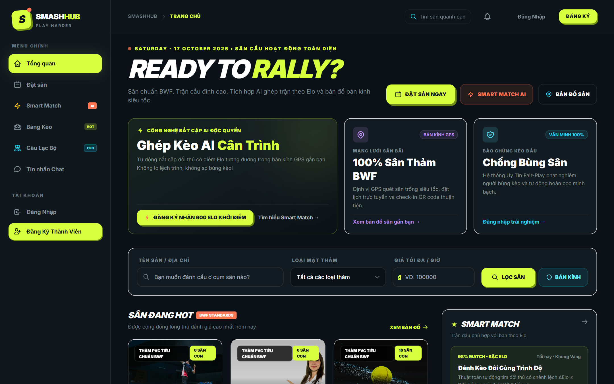
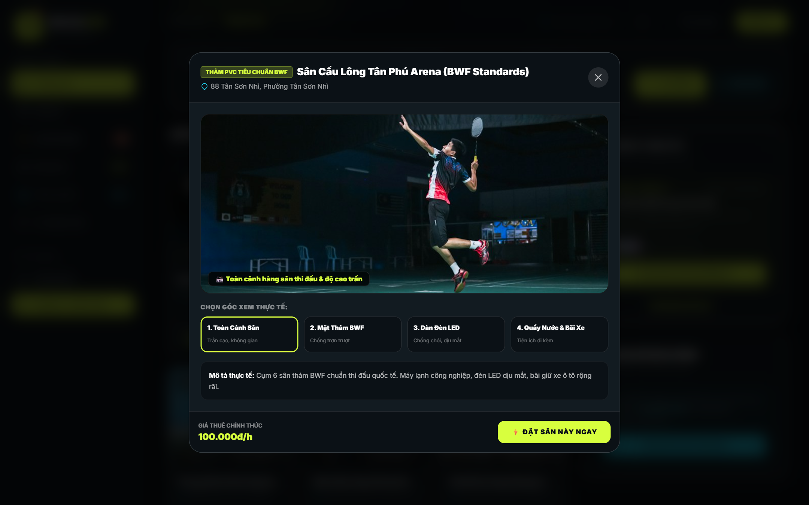
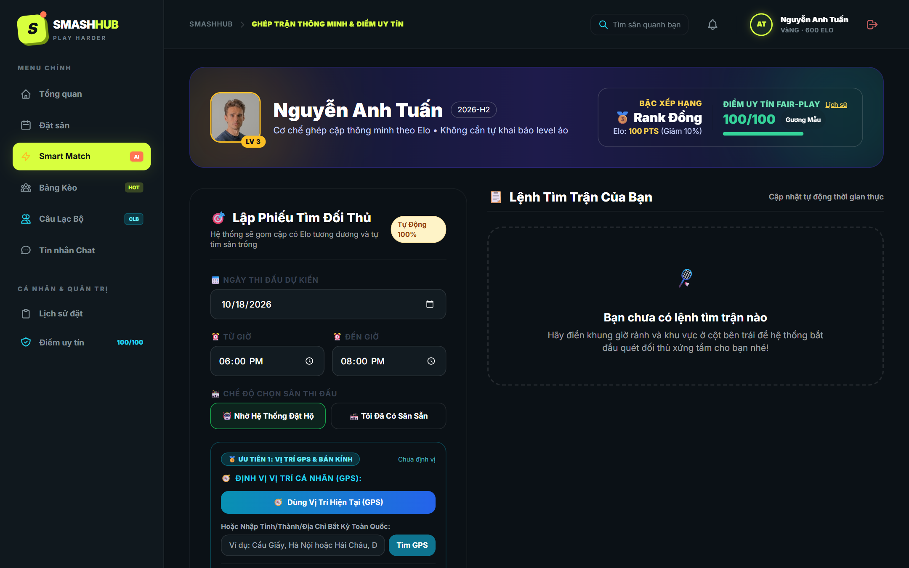
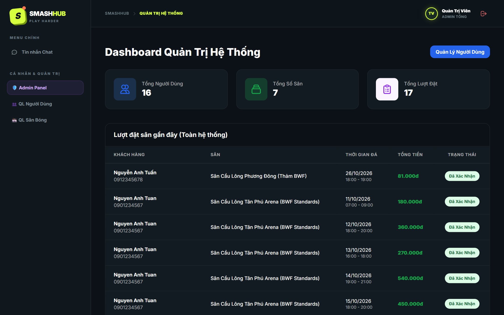

# 🏸 SMASHHUB - Nền Tảng Đặt Sân Cầu Lông & Ghép Trận AI (Smart Matchmaking)

[](https://www.php.net/)
[](https://www.mysql.com/)
[](https://tailwindcss.com/)
[](LICENSE)

**SMASHHUB** là nền tảng quản lý đặt sân cầu lông và kết nối cộng đồng lông thủ thông minh. Hệ thống tích hợp thuật toán **Ghép trận thông minh (Smart Match AI)** độc quyền theo trình độ Elo quốc tế và vị trí địa lý GPS Haversine, giải quyết triệt để bài toán thiếu người đánh, chênh lệch trình độ, chia tiền sân minh bạch (Split Bill 50/50) và chống bùng kèo (No-Show Fair-Play).

---

## 🌟 Tính Năng Cốt Lõi

### 1. 🤖 Trợ Lý AI Tìm & Đặt Sân Tự Động (AI Smart Booking 1-Click)
* **Xử lý ngôn ngữ tự nhiên (NLP Intent & Entity Parser)**: Người chơi chỉ cần nhập yêu cầu tìm sân bằng ngôn ngữ tự nhiên tiếng Việt (Ví dụ: *"Chiều nay 18h ở Bình Thạnh giá dưới 100k còn chỗ"*, *"Tối nay 19h quanh vị trí của tôi có thảm BWF"*).
* **Quét dữ liệu sân trống thời gian thực (Real-time Slot Checking)**: AI tự động phân tích khung giờ, kiểm tra trực tiếp vào CSDL và chỉ đề xuất các cụm sân **thực sự còn sân con trống**.
* **Định vị GPS Haversine & Chấm điểm đa tiêu chí (AI Relevance Ranking)**:
  $$\mathbf{Score} = (0.35 \times \text{Khoảng cách GPS}) + (0.30 \times \text{Giá tiền}) + (0.25 \times \text{Độ trống sân}) + (0.10 \times \text{Tiện ích thảm BWF})$$
* **Đặt sân 1-Click siêu tốc**: Hiển thị thẻ sân trực quan (khoảng cách km, số sân con còn trống, đơn giá) kèm nút **[⚡ Đặt Ngay 1-Click]** điền sẵn toàn bộ thông số, giúp người chơi chốt sân chỉ trong 3 giây.

### 2. 🎯 Ghép Trận Thông Minh (Smart Match AI) & Chia Đôi Hóa Đơn (Split Bill 50/50)
* **2 Chế độ linh hoạt**: *"Nhờ Hệ Thống Đặt Hộ"* (tự tìm sân trống trung tâm tiện nhất cho cả hai) hoặc *"Tôi Đã Có Sân Sẵn"*.
* **Phòng ghép sân & Giữ chỗ 15 phút**: Khi hai cơ thủ được ghép nối, hệ thống mở phòng đàm phán với thời hạn giữ chỗ 15 phút. Mỗi bên hoàn tất xác nhận và thanh toán 50% tiền sân (VietQR hoặc Tiền mặt tại sân).
* **Đàm phán đổi sân thời gian thực (Switch Pitch - Zero-Reload AJAX)**: Cho phép đề xuất đổi sang cụm sân trung tâm tiện hơn dựa trên khoảng cách GPS; đối thủ có thể Chấp thuận hoặc Từ chối tức thì mà không cần tải lại trang.
* **Thuật toán đa mục tiêu (Multi-objective Scoring)**:
  * 🥇 **Điểm Elo (50%)**: Ưu tiên ghép đối thủ có trình độ tương đương, biên độ lệch $\Delta\text{Elo} \le 100$.
  * 🥈 **Điểm Vị trí GPS (30%)**: Quét bán kính thực tế theo công thức Haversine (hoặc cùng Quận/Huyện dự phòng).
  * 🥉 **Thể thức thi đấu (20%)**: Khớp thể thức Đơn hoặc Đôi.
* **Trò chuyện nội bộ (Internal Chat Box)**: Nhắn tin trao đổi trực tiếp giữa hai bên và nhận thông báo tiến trình tự động.

### 2. 🏆 Hệ Thống Xếp Hạng Elo & 4 Bậc Rank Ưu Đãi
* **Mức khởi điểm tân thủ**: Đăng ký tài khoản nhận ngay **`100 Elo`** (Bậc **Rank Đồng**).
* **Thuật toán chuẩn quốc tế ($K\text{-factor} = 32$)**:
  * Tự động tính xác suất thắng kỳ vọng $E$ dựa trên chênh lệch Elo giữa 2 bên.
  * Thắng trận: Nhận điểm cộng theo hiệu số trình độ (bảo vệ động lực thi đấu: thắng luôn nhận tối thiểu **+15 Elo**).
  * Thua trận: Bị trừ điểm tương ứng (sàn an toàn không bao giờ âm dưới 0).
  * Hòa trận: Biến động nhẹ tùy theo kỳ vọng trước trận.
  * Cập nhật điểm và thông báo tức thì đến chuông thông báo cá nhân sau khi Chủ sân xác nhận kết quả.
* **Chính sách ưu đãi giảm giá tiền sân theo Rank**:
  * 💎 **Hạng Kim Cương** (Elo $\ge$ 1000): Giảm ngay **20%** tiền sân khi đặt và ghép kèo.
  * 🥇 **Hạng Vàng** (Elo $\ge$ 600): Giảm ngay **10%** tiền sân.
  * 🥈 **Hạng Bạc** (Elo $\ge$ 300): Giảm ngay **5%** tiền sân.
  * 🥉 **Hạng Đồng** (100 - 299 Elo): Giá niêm yết chuẩn cho tân thủ.

### 3. 🛡️ Điểm Uy Tín Fair-Play & Cơ Chế Chống Bùng Kèo (No-Show)
* **Điểm uy tín chuẩn**: **100/100 PTS**.
* **Thưởng Fair-Play**: **+2 PTS** khi đến sân hoàn tất trận đấu đúng hẹn.
* **Chế tài xử phạt hủy kèo minh bạch**:
  * 🟢 Hủy sớm (> 2 tiếng trước giờ đấu): Phạt nhẹ **-5 PTS**.
  * 🟡 Hủy cận giờ (1 - 2 tiếng trước giờ đấu): Phạt **-15 PTS**.
  * 🟠 Hủy sát giờ (< 1 tiếng trước giờ đấu): Phạt nặng **-25 PTS** và tạm khóa tìm trận 3 ngày.
  * 🔴 Bùng kèo (No-Show): Bị Chủ sân xác nhận vắng mặt sẽ phạt **-30 PTS Uy Tín**, **-50 Điểm Elo** và tạm khóa tìm trận 3 ngày.
* **Bảo vệ quyền lợi**: Nếu bị đối thủ bùng kèo, người chơi có mặt được bảo toàn điểm uy tín, bảo lưu tiền sân hoặc hỗ trợ nhận sân thi đấu.
* Tài khoản có điểm uy tín dưới **50 PTS** sẽ tự động bị tước quyền tham gia tính năng Ghép trận.

### 4. 👥 Cộng Đồng Câu Lạc Bộ (Badminton Clubs)
* **Quản lý CLB**: Thành lập câu lạc bộ, quản lý danh sách thành viên, cấu hình lịch sinh hoạt định kỳ và phân loại trình độ theo 4 bậc Rank.
* **Bảng tin nội bộ & Tuyển Slot Vãng Lai**: Đăng tin tuyển người giao lưu kèm mức phí đóng góp; người chơi tự do có thể xin gia nhập slot chỉ bằng 1 thao tác.

### 5. 🏟️ Phân Hệ Chủ Sân (Court Owner) & POS Bán Hàng Tại Quầy
* **Quản lý cụm sân**: Thêm/Sửa thông tin cụm sân, tọa độ GPS, số lượng sân con tiêu chuẩn BWF, đơn giá theo giờ.
* **POS Đặt Sân Tại Quầy (Walk-in)**: Tạo đơn trực tiếp cho khách vãng lai, tích hợp dịch vụ phụ trợ (nước suối, Revive, thuê vợt, cầu Hải Yến S90) và tính tổng hóa đơn tự động.
* **Lịch đặt sân dạng lưới (Court Schedule Grid)**: Giám sát toàn bộ trạng thái sân con theo khung giờ 06:00 - 22:00, check-in và duyệt thanh toán không tải lại trang.
* **Biểu Đồ Trực Quan (Chart.js Analytics)**:
  * 📈 Biểu đồ Doanh thu 7 ngày gần nhất (Line Chart Gradient).
  * ⏰ Biểu đồ Doughnut phân tích công suất và khung giờ cao điểm (Giờ vàng 18h - 22h).
* **Trọng tài trận đấu**: Duyệt thu 50% tiền mặt, xác nhận kết quả thi đấu cập nhật Elo, xử lý khiếu nại vắng mặt (No-Show).

### 6. 🎟️ Phân Hệ Bàn Trực Lễ Tân (Staff / Receptionist)
* Giao diện tối ưu cảm ứng cho máy tính bảng / POS tại quầy lễ tân.
* **Check-in 1-Click**: Tra cứu theo Mã đặt sân (`CKIN...`), Số điện thoại hoặc tên khách hàng.
* Hỗ trợ check-in riêng biệt từng người (Host/Guest) trong các đơn cáp kèo đôi.
* Phân quyền chi nhánh: Nhân viên chỉ được phép xem và check-in các đơn thuộc cụm sân mình phụ trách.

### 7. 👑 Phân Hệ Quản Trị Hệ Thống (Super Admin)
* Dashboard thống kê tổng quan doanh thu toàn sàn, số lượng sân đấu, đơn đặt và thành viên.
* Quản lý người dùng, phân quyền RBAC (`admin`, `owner`, `staff`, `user`), khóa/mở sân đấu.
* Cấp và gán tài khoản nhân viên lễ tân vào các cụm sân trực thuộc.

### 8. 🔒 Bảo Mật & Toàn Vẹn Hệ Thống (Security & Concurrency Safe)
* **Chống tranh chấp đặt sân (Concurrency-safe)**: Bọc toàn bộ quy trình kiểm tra và lưu đơn trong **InnoDB Database Transaction** kết hợp khóa bi quan `SELECT ... FOR UPDATE`, triệt tiêu hoàn toàn lỗi đặt trùng sân con (Race Condition).
* **Cơ chế giữ chỗ có hạn (Pending Timeout)**: Đơn đặt sân và vé chờ quá hạn 10-15 phút không hoàn tất thanh toán sẽ tự động được giải phóng dung lượng.
* **Bảo vệ CSRF & IDOR**: Mọi thao tác thay đổi dữ liệu đều chạy qua phương thức POST kèm xác thực `csrf_token`; phân quyền kiểm tra quyền sở hữu sân và đơn đặt nghiêm ngặt.
* **Cơ chế Quên Mật Khẩu an toàn**: Sinh mật khẩu tạm ngẫu nhiên, giới hạn số lần thử (tối đa 5 lần trong 15 phút) chống tấn công Brute Force.
* **An toàn Upload**: Kiểm tra MIME Type thực tế bằng `finfo`, giới hạn dung lượng, đổi tên tệp ngẫu nhiên và chặn thực thi PHP trong thư mục tải lên bằng `.htaccess`.
* **Chuẩn hóa UTF-8 toàn diện**: Hỗ trợ 100% tiếng Việt có dấu, DSN utf8mb4, `SET NAMES utf8mb4 COLLATE utf8mb4_unicode_ci`, miễn nhiễm lỗi Mojibake.

---

## 📸 Hình Ảnh Giao Diện Hệ Thống

> Các ảnh chụp giao diện chất lượng cao phục vụ báo cáo đồ án được lưu tại thư mục [`docs/screenshots/`](docs/screenshots/).

| Chức Năng | Hình Ảnh Minh Họa |
| :--- | :--- |
| **Trang Chủ Hệ Thống** |  |
| **Album Ảnh & Chi Tiết Sân BWF** |  |
| **Bộ Lọc Cụm Sân & Bản Đồ GPS** |  |
| **Ghép Kèo Thông Minh AI** |  |
| **Thanh Toán VietQR Sandbox** |  |
| **Cộng Đồng Câu Lạc Bộ** |  |
| **Bàn Lễ Tân Check-in 1-Click** |  |
| **Dashboard Chủ Sân (Chart.js)** |  |
| **Quản Trị Toàn Sàn (Super Admin)** |  |
| **Sơ Đồ Khung Giờ & Chọn Sân Con** |  |

---

## 🛠️ Yêu Cầu Kỹ Thuật & Cài Đặt

### 1. Yêu Cầu Môi Trường
* **PHP**: Phiên bản 7.4 trở lên (Tương thích tốt trên PHP 7.4 và PHP 8.x).
* **Database**: MySQL 5.7+ hoặc MariaDB 10.3+ (Hỗ trợ InnoDB Engine).
* **Web Server**: Apache hoặc Nginx (Hỗ trợ WAMP, XAMPP, Docker).
* **PHP Extensions**: `pdo`, `pdo_mysql`, `mbstring`, `fileinfo`.

### 2. Hướng Dẫn Cài Đặt Nhanh

#### Cách 1: Chạy bằng WAMP / XAMPP
1. Đặt thư mục dự án vào thư mục web server:
   - WAMP: `C:\wamp64\www\badminton` (hoặc `D:\wamp\www\badminton`)
   - XAMPP: `C:\xampp\htdocs\badminton`
2. Mở **phpMyAdmin** (`http://localhost/phpmyadmin`), tạo cơ sở dữ liệu mới:
   - Tên CSDL: `badminton_booking`
   - Bảng mã (Collation): `utf8mb4_unicode_ci`
3. Nhập (Import) tệp tin: [`badminton_booking.sql`](badminton_booking.sql).
4. Kiểm tra tệp cấu hình [`config/database.php`](config/database.php):
   ```php
   define('DB_HOST', '127.0.0.1');
   define('DB_PORT', '3306');
   define('DB_USER', 'root');
   define('DB_PASS', '');
   define('DB_NAME', 'badminton_booking');
   ```
5. Mở trình duyệt và truy cập: `http://localhost/badminton`

#### Cách 2: Chạy bằng Docker
```bash
docker-compose up -d
```
Ứng dụng sẽ tự động chạy tại địa chỉ: `http://localhost:8080` (CSDL port 33066).

---

## 🧪 Bộ Kiểm Thử Tự Động (Automated Testing)

> **Lưu ý Windows CLI:** Khi chạy kiểm thử trên Command Prompt hoặc PowerShell, hãy chuyển bảng mã sang UTF-8 bằng lệnh `chcp 65001` để hiển thị tiếng Việt chính xác.

Hệ thống tích hợp bộ kịch bản kiểm thử tự động toàn diện trong thư mục `tests/`:

```bash
# 1. Kiểm tra toàn vẹn bảng mã tiếng Việt UTF-8 và kết nối CSDL:
php tests/utf8_check.php

# 2. Kiểm thử Trợ lý AI Tìm & Đặt sân thông minh (NLP tiếng Việt, GPS & gợi ý sân trống):
php tests/ai_smart_booking_test.php

# 3. Kiểm thử an toàn tranh chấp Concurrency (giả lập 20 yêu cầu đặt sân cùng mili-giây):
php tests/concurrent_booking_test.php

# 4. Kiểm thử tích hợp toàn bộ luồng Smart Match AI (Ghép đôi -> Xác nhận 50/50 -> Báo kết quả -> Cập nhật Elo):
php tests/smart_match_flow_test.php

# 4. Kiểm thử Unit Test logic Matching (Node.js/Jest nếu có):
npm test

# 5. Kiểm thử chịu tải Stress Test Concurrency (k6):
k6 run tests/concurrent_join.js
```

---

## 👥 Danh Sách Tài Khoản Demo

| Vai trò (Role) | Tên đăng nhập (Username) | Mật khẩu (Password) | Chức năng kiểm thử chính |
| :--- | :--- | :--- | :--- |
| **Quản Trị Viên (Admin)** | `admin` | `123456` | Toàn quyền quản trị, duyệt sân, quản lý tài khoản |
| **Chủ Sân Demo** | `chusan_demo` | `123456` | Quản lý cụm sân, POS bán hàng, lịch lưới |
| **Chủ Sân Bình Thạnh** | `chusan1` | `123456` | Quản lý sân Bình Thạnh, duyệt thu 50% tiền mặt, xử phạt bùng kèo |
| **Nhân Viên Sân (Staff)** | `nhanvien1` | `123456` | Bàn lễ tân, check-in 1-Click bằng Mã đơn / SĐT |
| **Khách Hàng (User 1)** | `tiendung` | `123456` | Lập lệnh tìm trận Smart Match AI, đàm phán đổi sân |
| **Khách Hàng (User 2)** | `user` | `123456` | Đối thủ được AI bắt cặp, xác nhận thanh toán 50/50 |
| **Khách Hàng Mới** | `khach_alpha` | `123456` | Kiểm tra tài khoản tân thủ nhận 100 Elo (Rank Đồng) |

---

## 🗄️ Cấu Trúc Cơ Sở Dữ Liệu (14 Bảng Dữ Liệu Chuẩn)

1. `users`: Tài khoản thành viên, phân quyền RBAC, tọa độ GPS, điểm uy tín và liên kết quản lý cụm sân.
2. `pitches`: Cụm sân cầu lông, địa chỉ, kinh độ/vĩ độ GPS, số lượng sân con BWF, loại thảm và đơn giá theo giờ.
3. `bookings`: Đơn đặt sân, mã check-in (`CKIN...`), số sân con được cấp (`court_number`), phương thức và trạng thái thanh toán.
4. `matchmaking`: Hồ sơ trận cáp kèo, kết quả thi đấu, trạng thái thanh toán chia đôi và check-in riêng 2 bên.
5. `match_tickets`: Lệnh tìm trận Smart Match AI, bán kính quét GPS, thời hạn phòng ghép (`expires_at`), trạng thái xác nhận.
6. `messages`: Hộp thư trò chuyện trực tiếp và thông báo tự động giữa các cơ thủ.
7. `notifications`: Chuông thông báo hệ thống, thông báo biến động lịch đặt và kết quả điểm $\pm\text{Elo}$.
8. `reputation_logs`: Nhật ký biến động điểm Uy Tín Fair-Play (+2 hoàn thành, -5, -15, -25 khi hủy, -30 khi No-Show).
9. `reviews`: Đánh giá xếp hạng sao và nhận xét của khách hàng đối với từng cụm sân.
10. `services`: Danh mục mặt hàng dịch vụ phụ trợ (nước suối, Revive, thuê vợt, cầu thi đấu).
11. `user_scores`: Điểm tích lũy và bảng xếp hạng Elo cá nhân theo từng mùa giải (`season`).
12. `clubs`: Danh sách các Câu Lạc Bộ cầu lông và nhóm sinh hoạt thể thao định kỳ.
13. `club_members`: Thành viên CLB, vai trò (`leader`, `admin`, `member`) và trạng thái xét duyệt.
14. `club_posts`: Bảng tin nội bộ CLB và tin đăng tuyển slot vãng lai kèm chi phí chia sẻ.

---

## 📁 Cấu Trúc Thư Mục Dự Án

```
badminton/
├── assets/                  # CSS, JS, hình ảnh giao diện, thư mục uploads bảo mật
├── config/                  # Kết nối PDO Database & cơ chế Auto-migration
│   └── database.php
├── controllers/             # Bộ điều khiển mô hình MVC thuần
│   ├── AdminController.php
│   ├── AuthController.php
│   ├── BookingController.php
│   ├── ClubController.php
│   ├── HomeController.php
│   ├── MatchmakingController.php
│   ├── MessageController.php
│   ├── NotificationController.php
│   ├── OwnerController.php
│   ├── StaffController.php
│   └── UserController.php
├── models/                  # Các lớp thực thể và thuật toán nghiệp vụ
│   ├── AiSmartBooking.php   # Trợ lý AI Đặt Sân: NLP tiếng Việt, GPS Haversine, xếp hạng gợi ý
│   ├── Booking.php          # Quản lý đơn đặt, chống trùng lịch Race Condition
│   ├── Club.php             # Quản lý Câu lạc bộ & slot vãng lai
│   ├── MatchTicket.php      # Thuật toán Matching AI, Haversine, đàm phán đổi sân
│   ├── Matchmaking.php      # Quản lý trận đấu, cập nhật kết quả
│   ├── Pitch.php            # Cụm sân, định vị GPS, đơn giá
│   ├── Ranking.php          # Thuật toán xếp hạng Elo K=32, ưu đãi theo Rank
│   ├── Reputation.php       # Điểm Uy Tín Fair-Play, xử lý bùng kèo (No-Show)
│   └── User.php             # Người dùng, phân quyền RBAC
├── views/                   # Giao diện người dùng thuần HTML5/Tailwind/Vanilla JS
│   ├── admin/               # Quản trị toàn sàn
│   ├── auth/                # Đăng nhập, đăng ký, quên mật khẩu an toàn
│   ├── clubs/               # Danh sách CLB, bảng tin giao lưu
│   ├── matchmaking/         # Màn hình cáp kèo Smart Match AI real-time
│   ├── owner/               # Dashboard chủ sân, biểu đồ Chart.js, lịch lưới
│   ├── staff/               # Bàn trực lễ tân màn hình cảm ứng
│   ├── layout.php           # Khung sườn giao diện chung
│   └── home.php             # Trang chủ, tìm kiếm bán kính bản đồ
├── tests/                   # Bộ kịch bản kiểm thử tự động (Concurrency, Flow, UTF-8)
├── docs/screenshots/        # Ảnh chụp màn hình phục vụ báo cáo đồ án
├── .editorconfig            # Quy chuẩn định dạng tệp tin UTF-8
├── .htaccess                # Cấu hình bảo vệ thư mục & chuẩn hóa charset UTF-8
├── Dockerfile               # Cấu hình container PHP 8.2 Apache
├── docker-compose.yml       # Điều phối container web và MariaDB
├── badminton_booking.sql    # Bản sao lưu cơ sở dữ liệu mẫu chuẩn hóa UTF-8
├── index.php                # Router điều hướng chính, CSRF Middleware
└── README.md                # Tài liệu hướng dẫn sử dụng và triển khai dự án
```

---

## 📄 Bản Quyền & Học Thuật
Dự án được xây dựng phục vụ nghiên cứu, đồ án tốt nghiệp và ứng dụng thực tiễn trong chuyển đổi số thể thao phong trào. Mọi đóng góp và đề xuất cải tiến đều được hoan nghênh!
