# SMASHHUB - Nen Tang Dat San Cau Long & Cap Keo Thong Minh Tich Hop Machine Learning

[](https://www.php.net/)
[](https://www.mysql.com/)
[](https://tailwindcss.com/)
[](ai_engine/)
[](LICENSE)

**SMASHHUB** la nen tang quan ly dat san cau long va ket noi cong dong long thu toan dien. He thong so huu **Phan he Machine Learning NLP tu huan luyen (In-House AI Engine)** ket hop thuat toan **Ghep tran thong minh (Smart Match AI)** doc quyen theo trinh do Elo quoc te va vi tri dia ly GPS Haversine, giai quyet triet de bai toan thieu nguoi danh, chenh lech trinh do, chia tien san minh bach (Split Bill 50/50) va chong bung keo (No-Show Fair-Play).

---

## Tinh Nang Cot Loi

### 1. Phan He Machine Learning NLP Tu Huan Luyen (In-House AI Engine)
Kien truc AI duoc phat trien hoan toan doc lap bang thuan toan toan hoc (Pure PHP), khong phu thuoc API ben ngoai, dam bao toc do suy luan duoi 2ms:
* **Tien xu ly ngon ngu N-Gram (`ai_engine/Tokenizer.php`)**: Tach tu vung tieng Viet va tao dac trung Unigram + Bigram ket hop xu ly stopword the thao.
* **Trich xuat dac trung TF-IDF (`ai_engine/TfIdfVectorizer.php`)**: Xay dung ma tran TF-IDF chuan hoa $L2$ voi hon 300 chieu tu vung chuyen mon cau long.
* **Bo phan loai Multinomial Naive Bayes (`ai_engine/NaiveBayesClassifier.php`)**:
  * Tinh toan xac suat tien dinh $P(C_k)$ va hop ly co dieu kien $P(w_i|C_k)$ voi ky thuat lam min Laplace ($\alpha = 0.1$).
  * Hieu chinh do tu tin qua ham Softmax:
    $$P(C_k | \mathbf{x}) = \frac{\exp(\log P(C_k|\mathbf{x}))}{\sum_j \exp(\log P(C_j|\mathbf{x}))}$$
* **Tap du lieu chuyen mon (`ai_engine/dataset.json`)**: 163 mau cau phan bo can bang tren 10 nhom y dinh (Intent):
  1. `smart_booking`: Dat san theo yeu cau, dia diem, gio giac.
  2. `find_opponent`: Tim keo, ghep tran theo trinh do.
  3. `check_price`: Tra cuu gia gio, bang gia san BWF.
  4. `split_bill_info`: Co che chia doi hoa don 50/50 va chong bung keo.
  5. `radar_matching`: Radar quet ban danh theo vi tri GPS thuc te.
  6. `racket_advice`: Tu van chon vot cau long (cong, thu, can bang).
  7. `greeting`: Chao hoi va tiep don hoi vien.
  8. `bot_identity`: Gioi thieu he thong va cong nghe SmashHub.
  9. `weather_query`: Hoi thoi tiet va dieu kien danh cau.
  10. `calendar_schedule`: Tra cuu lich thi dau, thu va ngay thang.
* **Danh gia mo hinh 5-Fold Stratified Cross-Validation (`ai_engine/train.php`)**: Dat diem Macro F1-Score ~70%, thoi gian huan luyen chi khoang 40ms.
* **Bo loc an toan nguong tin cay (Confidence Guardrail >= 45%)**: Ngan chan hien tuong doan mo ngoai pham vi the thao; tu dong dieu huong nguoi dung ve cac chuyen mon cot loi.
* **Tich hop ngu canh thoi gian thuc (`ai_engine/GenerativeEngine.php`)**:
  * Ket noi Open-Meteo API lay nhiet do va thoi tiet thuc te theo toa do GPS.
  * Tinh toan thu, ngay thang am/duong lich Viet Nam.
  * Sinh loi khuyen the thao tam ly va dinh duong phu hop.

### 2. Radar Ket Noi Ban Danh Gan Day (Proximity Social Radar)
* **Quet toa do thuc te (Haversine GPS)**: Tinh khoang cach chinh xac giua cac long thu dang cho keo trong ban kinh 1 - 15 km.
* **Loi moi 1-Click (Instant Invite)**: Gui loi moi truc tiep den doi thu phu hop tren radar.
* **Xac nhan dong thuan (Mutual Consensus Zero-Reload)**: Khi ca hai dong y, he thong tu dong hop nhat vao phong ghep chung ma khong can tai lai trang.

### 3. Tro Ly AI Tim & Dat San 1-Click (AI Smart Booking)
* **Xu ly ngon ngu tu nhien (Entity Extraction)**: Trach loc thong minh quan/huyen, gio choi, gia toi da va tien ich tu cau chat thuan tuy.
* **Kiem tra slot trong thoi gian thuc**: Truy van truc tiep vao co so du lieu de chi de xuat san thuc su con trong.
* **Xep hang goi y da muc tieu (AI Relevance Ranking)**:
  $$\mathbf{Score} = (0.35 \times \text{Khoang cach GPS}) + (0.30 \times \text{Gia tien}) + (0.25 \times \text{Do trong san}) + (0.10 \times \text{Tien ich BWF})$$
* **The dat san 1-Click**: Dien san thong so vao form giup hoan tat dat cho chi trong 3 giay.

### 4. Ghep Tran Thong Minh (Smart Match AI) & Chia Doi Hoa Don (Split Bill 50/50)
* **2 Che do linh hoat**: "Nho He Thong Dat Ho" (chon san trung tam toi uu) hoac "Toi Da Co San San".
* **Phong ghep giu cho 15 phut**: Moi ben hoan tat thanh toan 50% qua VietQR Sandbox hoac tien mat.
* **Dam phan doi san thoi gian thuc (Switch Pitch)**: De xuat doi san trung tam tien hon; doi thu chap thuan hoac tu choi bang AJAX.
* **Thuat toan cham diem 3 tieu chi**:
  * Diem Elo (50%): Uu tien do lech $\Delta\text{Elo} \le 100$.
  * Diem Vi tri GPS (30%): Ban kinh thuc te theo cong thuc Haversine.
  * The thuc thi dau (20%): Khop the thuc Don hoac Doi.
* **Hop thu tro chuyen noi bo**: Chat truc tiep va nhan thong bao tien trinh tu dong.

### 5. He Thong Xep Hang Elo & 4 Bac Rank Uu Dai
* **Muc khoi diem**: 100 Elo (Rank Dong, `Ranking::DEFAULT_ELO = 100`).
* **Thuat toan chuan quoc te ($K\text{-factor} = 32$)**:
  * Tinh xac suat thang ky vong $E$ dua tren chenh lech Elo.
  * Thang tran: Cong diem theo hieu so trinh do (cong thuc Elo chuan $K=32$, khong ap dung muc cong toi thieu co dinh).
  * Thua tran: Tru diem tuong ung theo cong thuc Elo chuan.
  * San diem: Gioi han san 0 Elo (diem khong bao gio am).
* **Chinh sach uu dai giam gia tien san theo Rank**:
  * Hang Kim Cuong (Elo >= 1000): Giam ngay 20% tien san.
  * Hang Vang (Elo >= 600): Giam ngay 10% tien san.
  * Hang Bac (Elo >= 300): Giam ngay 5% tien san.
  * Hang Dong (100 - 299 Elo): Gia niem yet chuan.

### 6. Diem Uy Tin Fair-Play & Co Che Chong Bung Keo (No-Show)
* **Diem uy tin chuan**: 100/100 PTS.
* **Thuong Fair-Play**: +2 PTS khi hoan tat tran dau dung hen.
* **Che tai xu phat**:
  * Huy som (> 2 tieng): Tru 5 PTS.
  * Huy can gio (1 - 2 tieng): Tru 15 PTS.
  * Huy sat gio (< 1 tieng): Tru 25 PTS, khoa tim tran 3 ngay.
  * Bung keo (No-Show): Chu san xac nhan phat -30 PTS Uy Tin, -50 Diem Elo va khoa tim tran 3 ngay.
* **Nguong bao ve**: Diem uy tin duoi 50 PTS se bi khoa hoan toan tinh nang Ghep tran.

### 7. Cong Dong Cau Lac Bo (Badminton Clubs)
* **Quan ly CLB**: Thanh lap nhom, quan ly hoi vien, phan loai trinh do theo 4 bac Rank.
* **Bang tin & Tuyen Slot Vang Lai**: Dang tin giao luu kem muc phi chia se; xin gia nhap slot 1 thao tac.

### 8. Phan He Chu San (Court Owner) & POS Ban Hang
* **Quan ly cum san**: So luong san con BWF, gia theo gio, toa do GPS.
* **POS Ban Hang Tai Quay (Walk-in)**: Tao don truc tiep, tich hop nuoc uong, thue vot, cau thi dau.
* **Lich dat san dang luoi (Court Schedule Grid)**: Giam sat 06:00 - 22:00, check-in khong tai lai trang.
* **Bieu do Chart.js Analytics**: Doanh thu 7 ngay va phan tich khung gio cao diem.
* **Trong tai tran dau**: Duyet thu 50% tien mat, xac nhan ket qua cap nhat Elo, xu ly bung keo.

### 9. Phan He Ban Truc Le Tan (Staff / Receptionist)
* Giao dien toi uu cam ung tablet / POS.
* Check-in 1-Click bang Ma don (`CKIN...`), So dien thoai hoac ho ten.
* Check-in doc lap tung nguoi (Host / Guest) trong cac don cap keo.
* Phan quyen theo cum san duoc phan cong (`assigned_pitch_id`).

### 10. Phan He Quan Tri He Thong (Super Admin)
* Thong ke toan san: Doanh thu, luot dat, cum san, thanh vien.
* Quan ly nguoi dung va phan quyen RBAC (`admin`, `owner`, `staff`, `user`).
* Cap quyen va gan nhan vien le tan vao cac cum san.

### 11. Bao Mat & Toan Ven He Thong (Concurrency Safe)
* **Chong tranh chap dat san (Race-Condition Safe)**: Database Transaction ket hop khoa bi quan `SELECT ... FOR UPDATE`.
* **Giai phong giu cho tu dong**: Don qua han 10 - 15 phut tu dong hoan tra slot.
* **Bao ve CSRF & IDOR**: Token xac thuc cho moi yeu cau POST.
* **Chuan hoa UTF-8 toan dien**: DSN `utf8mb4`, ho tro tieng Viet co dau 100%.

---

## Hinh Anh Giao Dien & Ban Ve Thiet Ke He Thong

> Toan bo ban ve phac thao (Wireframe) va hinh anh giao dien chup thuc te phuc vu Bao cao Khoa luan Tot nghiep duoc luu tru tai thu muc [`docs/screenshots/`](docs/screenshots/) va [`docs/screenshots/thesis/`](docs/screenshots/thesis/).

### 1. Ban Ve Phac Thao Giao Dien (Wireframes - Muc 3.8 Bao Cao Khoa Luan)

Cac ban ve Wireframe chuan ky thuat phan mem duoc thiet ke theo Style Guide (3.8.1) va Layout Structure (3.8.2), the hien quy uoc mau trang thai Timeline san va bo cuc 2 phan he (Customer Layout & Dashboard Layout):

| Ma Hinh | Ten Ban Ve Wireframe | Hinh Anh Phac Thao |
| :--- | :--- | :--- |
| **Hinh 3.8.1** | **Wireframe Trang chu & Tra cuu cum san tich hop ban do GPS**<br>*(Thanh loc Quan/Gia/Tien ich, danh sach the san ben trai, ban do Leaflet GPS radar ben phai)* | 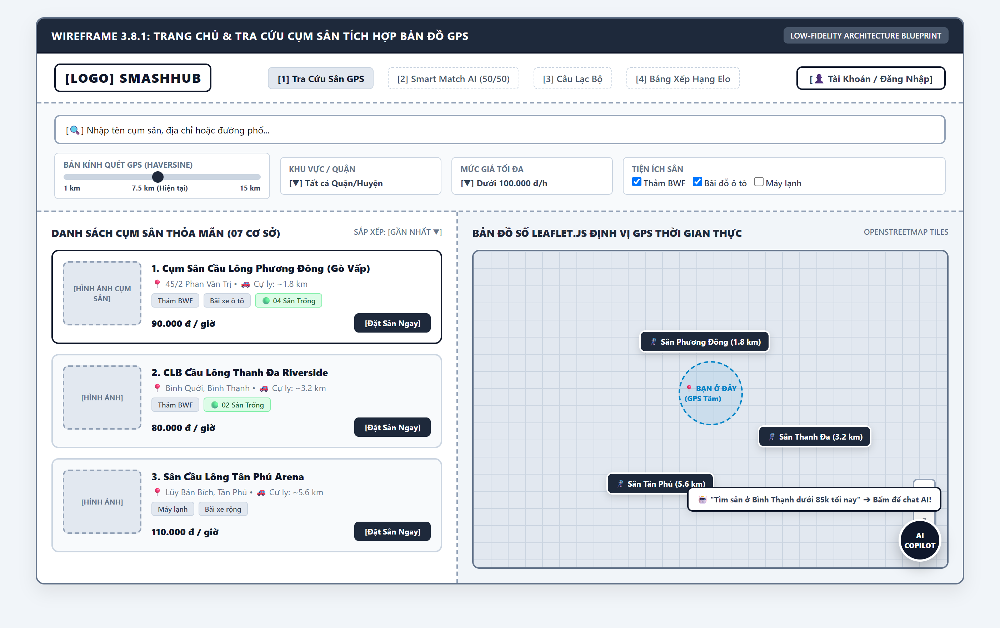 |
| **Hinh 3.8.2** | **Wireframe Man hinh chon khung gio san & Thanh toan VietQR**<br>*(Luoi Timeline san con theo gio, danh muc ban kem, khung VietQR dong dem nguoc 10 phut)* | 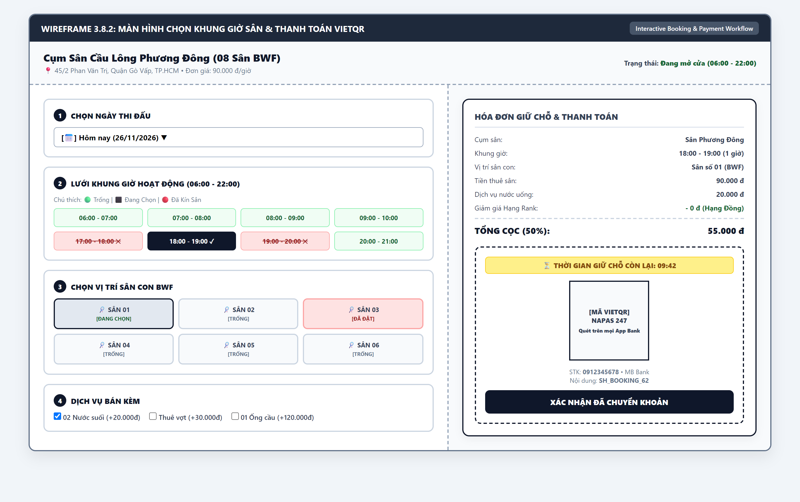 |
| **Hinh 3.8.3** | **Wireframe Man hinh Goi y ghep san thong minh & Tro ly AI Copilot**<br>*(Bo loc Elo/GPS, the phong ghep chia doi 50/50, khung chat AI Copilot tu van san)* | 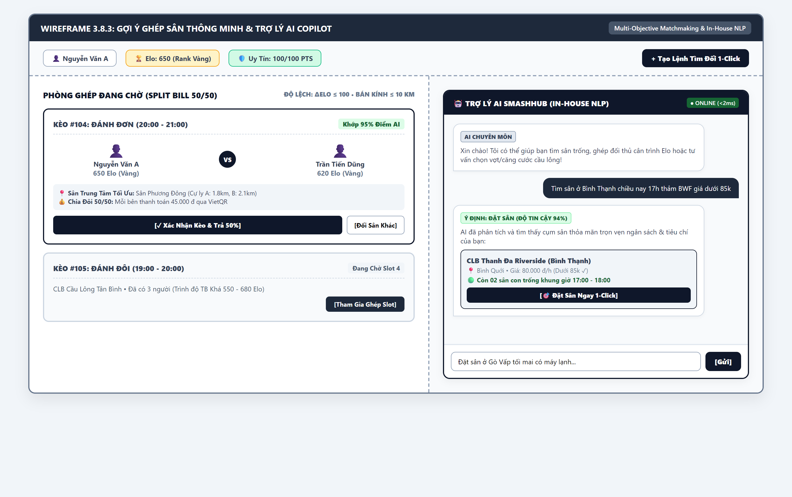 |
| **Hinh 3.8.4** | **Wireframe Man hinh Check-in tiep don & Quan ly lich san**<br>*(O quet QR/Barcode tiep don, check-in doc lap 2 ben, xac nhan thu tien mat 50%, Timeline co so)* | 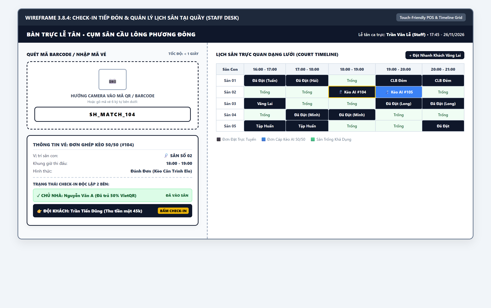 |

---

### 2. Giao Dien Hien Thuc Hoa Theo 4 Nhom Vai Tro (Muc 4.3 Bao Cao Khoa Luan)

He thong SMASHHUB cung cap giao dien truc quan, chuyen biet theo dung phan quyen RBAC cua tung nhom tac nhan:

#### 2.1. Phan He Khach Hang (Customer / Player)
| Ma Hinh | Ten Giao Dien Chuc Nang | Hinh Anh Thuc Te |
| :--- | :--- | :--- |
| **Hinh 4.3.1** | **Giao dien Trang chu va Ban do tim kiem cum san GPS**<br>*(Bo loc dia ly, tien ich san va ban do Leaflet.js tinh khoang cach theo cong thuc Haversine)* | 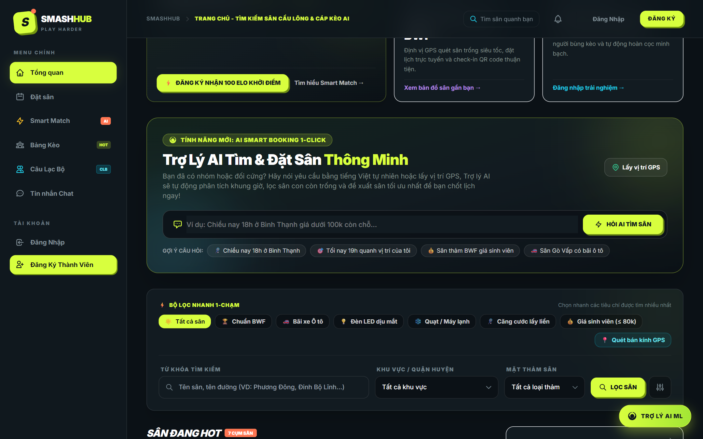 |
| **Hinh 4.3.2** | **Giao dien chon khung gio dat san va thanh toan ma VietQR**<br>*(Chon san con tren luoi Timeline, chon dich vu va quet ma VietQR dong Napas 247)* | 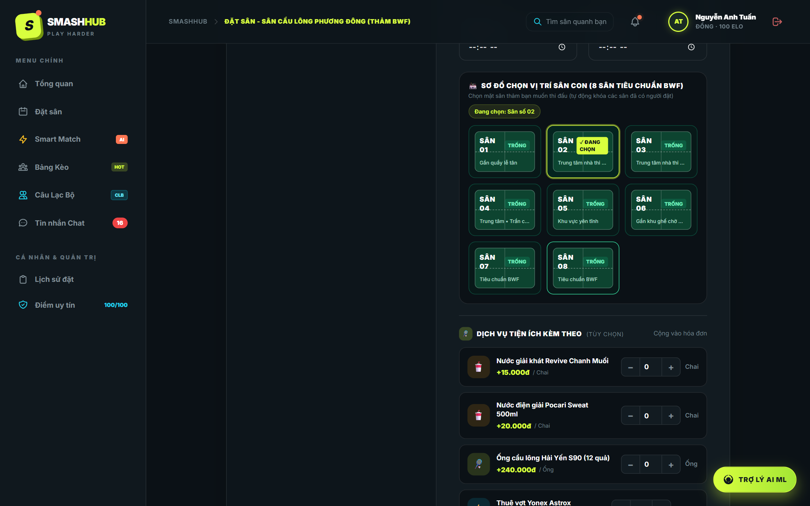 |
| **Hinh 4.3.3** | **Giao dien Goi y ghep san thong minh va Bang xep hang Elo**<br>*(Phong ghep tuong thich ban kinh <= 10km, delta Elo <= 200, chia doi 50/50, BXH Elo)* | 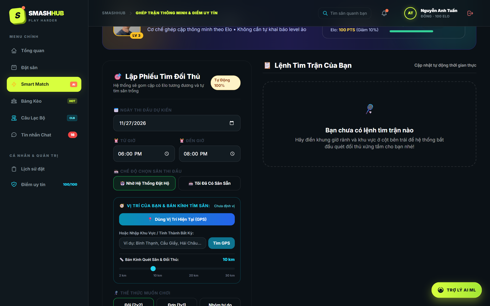 |
| **Hinh 4.3.4** | **Giao dien hoi thoai Tro ly AI Copilot goi y dat san**<br>*(Boc tach tu nhien khu vuc, thoi gian, ngan sach va de xuat the san kem nut Dat ngay)* | 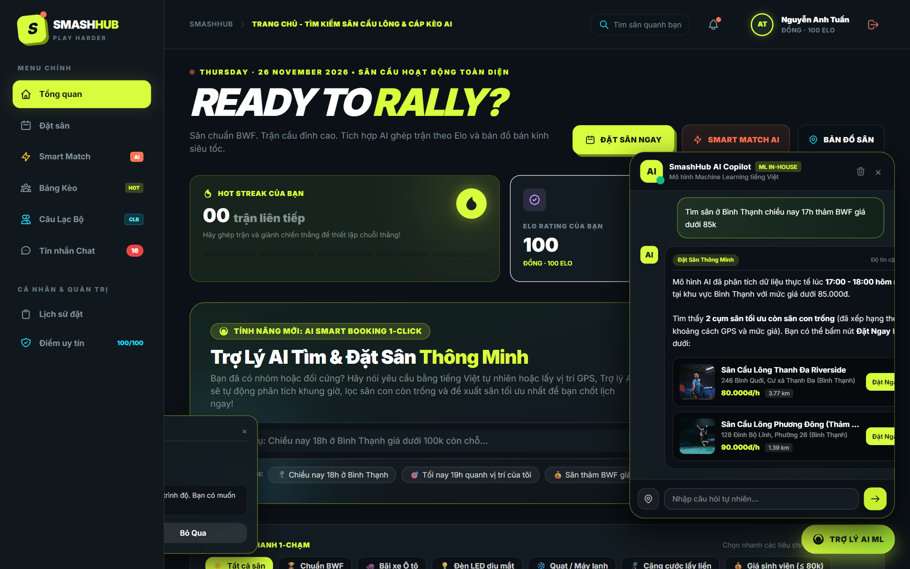 |

#### 2.2. Phan He Chu San (Court Owner)
| Ma Hinh | Ten Giao Dien Chuc Nang | Hinh Anh Thuc Te |
| :--- | :--- | :--- |
| **Hinh 4.3.5** | **Giao dien quan ly lich san Timeline va ban hang tai quay (Walk-in POS)**<br>*(Trang thai tat ca san con theo truc thoi gian thuc, tao don nhanh, ban kem do uong/vot)* | 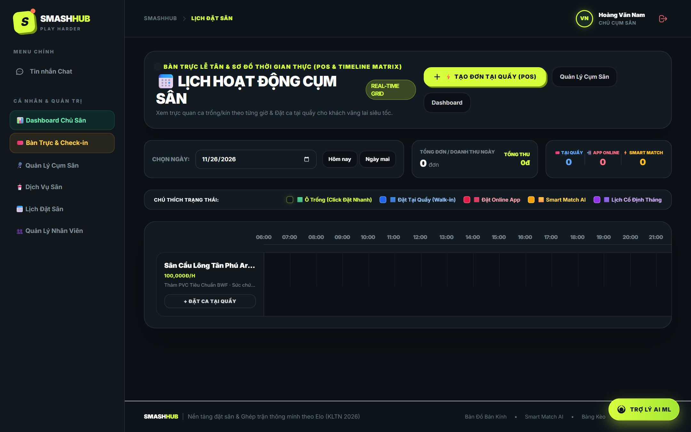 |
| **Hinh 4.3.6** | **Giao dien quan ly danh sach va phan quyen nhan vien**<br>*(Tao tai khoan le tan, phan cong cum san truc tiep don, kich hoat/khoa tai khoan)* | 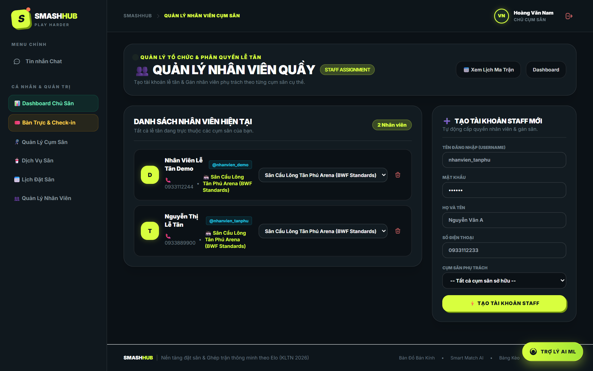 |

#### 2.3. Phan He Nhan Vien Truc Quay (Staff / Receptionist)
| Ma Hinh | Ten Giao Dien Chuc Nang | Hinh Anh Thuc Te |
| :--- | :--- | :--- |
| **Hinh 4.3.7** | **Giao dien Check-in tiep don va soat ve tai quay cua Nhan vien**<br>*(Quet ma QR/Barcode/SDT, check-in doc lap Host/Guest trong phong ghep, thu tien mat)* | 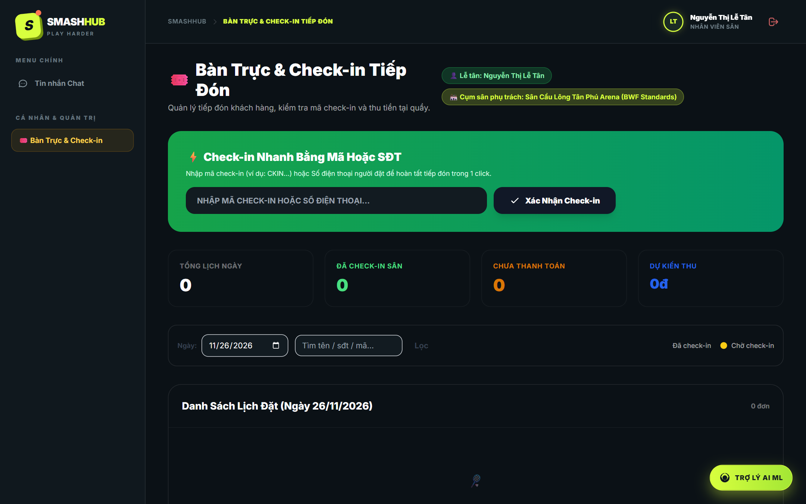 |

#### 2.4. Phan He Quan Tri Vien (Super Admin)
| Ma Hinh | Ten Giao Dien Chuc Nang | Hinh Anh Thuc Te |
| :--- | :--- | :--- |
| **Hinh 4.3.8** | **Giao dien Dashboard Quan tri vien va bieu do thong ke doanh thu**<br>*(Tong hop chi so toan he thong, bieu do Chart.js doanh thu, duyet cum san va CLB)* | 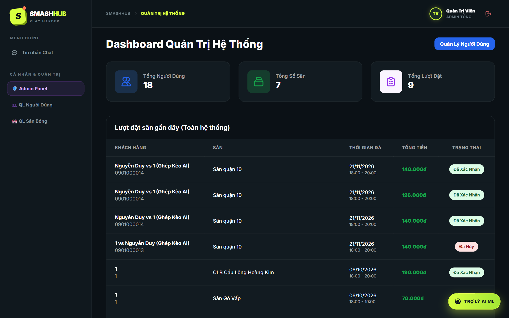 |

---

### 3. Thu Vien Anh Chuc Nang Bo Sung (Full UI Gallery)

| Chuc Nang | Hinh Anh Minh Hoa |
| :--- | :--- |
| **Album Anh & Chi Tiet San BWF** |  |
| **Bo Loc Cum San & Ban Do GPS** |  |
| **Ghep Keo Thong Minh AI** |  |
| **Thanh Toan VietQR Sandbox** | 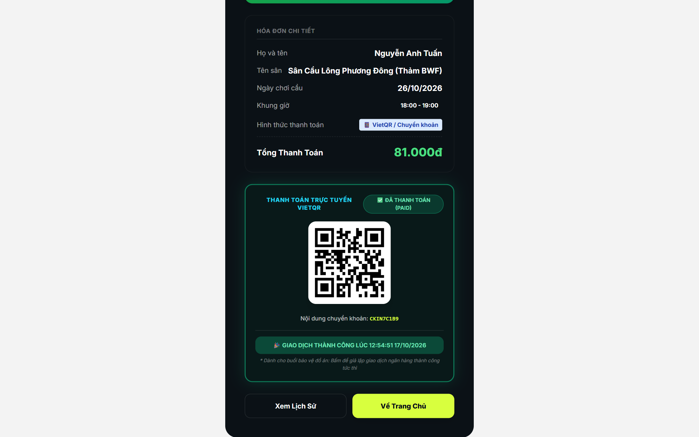 |
| **Cong Dong Cau Lac Bo** |  |
| **So Do Khung Gio & Chon San Con** | 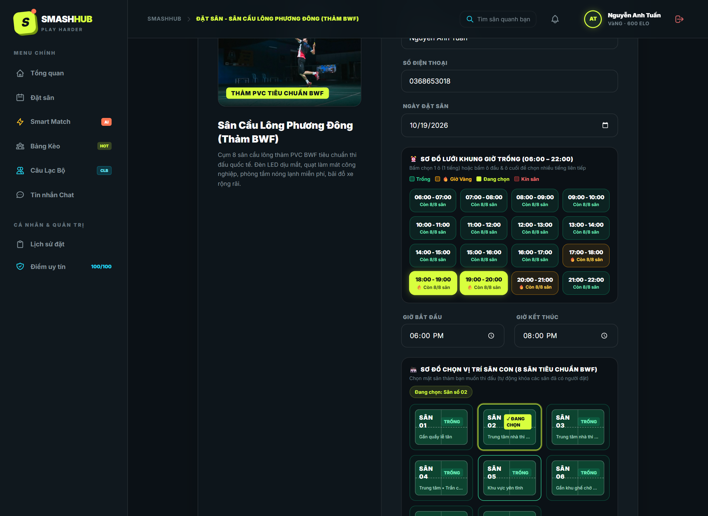 |
| **Giao Dien Di Dong (Responsive)** | 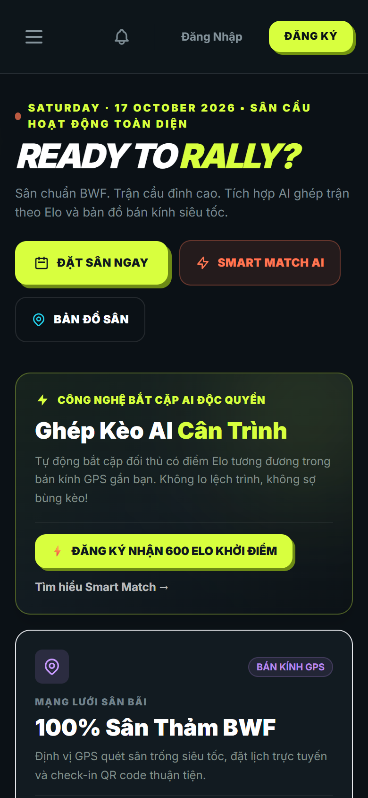 |

---

## Yeu Cau Ky Thuat & Cai Dat

### 1. Yeu Cau Moi Truong
* **PHP**: Phien ban 7.4 tro len (Tuong thich tot tren PHP 7.4 va PHP 8.x).
* **Database**: MySQL 5.7+ hoac MariaDB 10.3+ (InnoDB Engine ho tro Transaction).
* **Web Server**: Apache hoac Nginx (WAMP, XAMPP, Docker).
* **PHP Extensions**: `pdo`, `pdo_mysql`, `mbstring`, `fileinfo`.

### 2. Huong Dan Cai Dat Nhanh

#### Cach 1: Chay bang WAMP / XAMPP
1. Dat thu muc du an vao thu muc web server:
   - WAMP: `C:\wamp64\www\badminton` (hoac `D:\wamp\www\badminton`)
   - XAMPP: `C:\xampp\htdocs\badminton`
2. Mo **phpMyAdmin** (`http://localhost/phpmyadmin`), tao co so du lieu moi:
   - Ten CSDL: `badminton_booking`
   - Bang ma (Collation): `utf8mb4_unicode_ci`
3. Nhap (Import) tep tin: [`badminton_booking.sql`](badminton_booking.sql).
4. Kiem tra tep cau hinh [`config/database.php`](config/database.php):
   ```php
   define('DB_HOST', '127.0.0.1');
   define('DB_PORT', '3306');
   define('DB_USER', 'root');
   define('DB_PASS', '');
   define('DB_NAME', 'badminton_booking');
   ```
5. Mo trinh duyet va truy cap: `http://localhost/badminton`

#### Cach 2: Chay bang Docker
```bash
docker-compose up -d
```
Ung dung se tu dong chay tai dia chi: `http://localhost:8080` (CSDL port 33066).

---

## Bo Kiem Thu Tu Dong (Automated Testing)

> **Luu y Windows CLI:** Chay lenh `chcp 65001` de hien thi tieng Viet UTF-8 dung chuan trong Command Prompt hoac PowerShell.

```bash
# 1. Kiem tra toan ven bang ma tieng Viet UTF-8 va ket noi CSDL:
php tests/utf8_check.php

# 2. Kiem thu an toan tranh chap Concurrency (Race-Condition Safe gia lap dat trung mili-giay):
php tests/concurrent_booking_test.php

# 3. Kiem thu tich hop toan bo luong Smart Match AI (Ghep doi -> Xac nhan 50/50 -> Elo):
php tests/smart_match_flow_test.php

# 4. Kiem thu Tro ly AI Dat San & Xep hang da tieu chi (NLP tieng Viet, GPS Haversine):
php tests/ai_smart_booking_test.php

# 5. Kiem thu Radar ket noi ban danh gan day (Proximity Social Radar):
php tests/nearby_radar_test.php

# 6. Kiem thu toan dien Phan he Machine Learning NLP tu huan luyen (10 Intent, Confidence Guardrail):
php tests/ai_engine_ml_test.php

# 7. Kiem thu AI Copilot chu dong tim tran, tim doi thu & tao ve 1-Click:
php tests/ai_matchmaker_copilot_test.php

# 8. Huan luyen & danh gia cheo mo hinh Machine Learning (5-Fold Cross Validation):
php ai_engine/train.php

# 9. Kiem thu Unit Test logic Matching (Node.js/Jest):
npm test

# 10. Kiem thu chiu tai Stress Test Concurrency (k6):
k6 run tests/concurrent_join.js
```

---

## Danh Sach Tai Khoan Demo

| Vai tro (Role) | Ten dang nhap (Username) | Mat khau (Password) | Chuc nang kiem thu chinh |
| :--- | :--- | :--- | :--- |
| **Quan Tri Vien (Admin)** | `admin` | `123456` | Toan quyen quan tri, duyet san, quan ly tai khoan |
| **Chu San Demo** | `chusan_demo` | `123456` | Quan ly cum san, POS ban hang, lich luoi |
| **Chu San Binh Thanh** | `chusan1` | `123456` | Quan ly san Binh Thanh, duyet thu 50% tien mat, xu phat bung keo |
| **Nhan Vien San (Staff)** | `nhanvien1` | `123456` | Ban le tan, check-in 1-Click bang Ma don / SDT |
| **Khach Hang (User 1)** | `tiendung` | `123456` | Lap lenh tim tran Smart Match AI, dam phan doi san |
| **Khach Hang (User 2)** | `user` | `123456` | Doi thu duoc AI bat cap, xac nhan thanh toan 50/50 |
| **Khach Hang Moi** | `khach_alpha` | `123456` | Kiem tra tai khoan tan thu nhan 100 Elo (Rank Dong) |

---

## Cau Truc Co So Du Lieu (15 Bang Du Lieu Chuan)

1. `users`: Tai khoan hoi vien, phan quyen RBAC, toa do GPS, diem uy tin va lien ket cum san.
2. `pitches`: Cum san cau long, dia chi, kinh do/vi do GPS, so luong san con BWF, loai tham va don gia theo gio.
3. `bookings`: Don dat san, ma check-in (`CKIN...`), so san con duoc cap (`court_number`), trang thai thanh toan.
4. `matchmaking`: Ho so tran cap keo, ket qua thi dau, trang thai thanh toan chia doi va check-in rieng 2 ben.
5. `match_tickets`: Lenh tim tran Smart Match AI, ban kinh quet GPS, thoi han phong ghep, trang thai xac nhan.
6. `radar_invites`: Bang quan ly loi moi bat cap truc tiep tren Radar ban danh gan day.
7. `messages`: Hop thu tro chuyen truc tiep va thong bao tien trinh tu dong giua cac co thu.
8. `notifications`: Chuong thong bao he thong, bien dong lich dat va ket qua diem Elo.
9. `reputation_logs`: Nhat ky bien dong diem Uy Tin Fair-Play (+2 hoan thanh, -5/-15/-25 khi huy, -30 khi No-Show).
10. `reviews`: Danh gia xep hang sao va nhan xet cua khach hang doi voi tung cum san.
11. `services`: Danh muc mat hang dich vu phu tro (nuoc suoi, Revive, thue vot, cau thi dau).
12. `user_scores`: Diem tich luy va bang xep hang Elo ca nhan theo tung mua giai (`season`).
13. `clubs`: Danh sach cac Cau Lac Bo cau long va nhom sinh hoat the thao dinh ky.
14. `club_members`: Thanh vien CLB, vai tro (`leader`, `admin`, `member`) va trang thai xet duyet.
15. `club_posts`: Bang tin noi bo CLB va tin dang tuyen slot vang lai kem chi phi chia se.

---

## Cau Truc Thu Muc Du An

```
badminton/
├── ai_engine/                   # Phan he Machine Learning NLP tu huan luyen
│   ├── dataset.json             # Tap du lieu 163 mau cau tieng Viet 10 Intent
│   ├── GenerativeEngine.php     # Sinh phan hoi ngu canh thoi tiet & thoi gian thuc
│   ├── model_weights.json       # Trong so va xac suat mo hinh da hoc
│   ├── NaiveBayesClassifier.php # Thuat toan phan loai Multinomial Naive Bayes
│   ├── Predictor.php            # Bo suy luan thoi gian thuc & Entity Extractor
│   ├── TfIdfVectorizer.php      # Ma tran vector dac trung TF-IDF chuan hoa L2
│   ├── Tokenizer.php            # Tach tu va sinh N-Gram tieng Viet
│   └── train.php                # Kich ban huan luyen 5-Fold Cross Validation
├── assets/                      # CSS, JS, hinh anh giao dien, thu muc uploads bao mat
├── config/                      # Ket noi PDO Database & co che Auto-migration
│   └── database.php
├── controllers/                 # Bo dieu khien mo hinh MVC thuan
│   ├── AdminController.php
│   ├── AuthController.php
│   ├── BookingController.php
│   ├── ClubController.php
│   ├── HomeController.php
│   ├── MatchmakingController.php
│   ├── MessageController.php
│   ├── NotificationController.php
│   ├── OwnerController.php
│   ├── StaffController.php
│   └── UserController.php
├── models/                      # Cac lop thuc the va thuat toan nghiep vu
│   ├── AiSmartBooking.php       # Tro ly AI Dat San: NLP, GPS Haversine, xep hang
│   ├── Booking.php              # Quan ly don dat, chong trung lich Race Condition
│   ├── Club.php                 # Quan ly Cau lac bo & slot vang lai
│   ├── MatchTicket.php          # Thuat toan Matching AI, Haversine, dam phan doi san, Radar
│   ├── Matchmaking.php          # Quan ly tran dau, cap nhat ket qua Elo
│   ├── Pitch.php                # Cum san, dinh vi GPS, don gia
│   ├── Ranking.php              # Thuat toan xep hang Elo K=32, uu dai theo Rank
│   ├── Reputation.php           # Diem Uy Tin Fair-Play, xu ly bung keo (No-Show)
│   └── User.php                 # Nguoi dung, phan quyen RBAC
├── views/                       # Giao dien nguoi dung thuan HTML5/Tailwind/Vanilla JS
│   ├── admin/                   # Quan tri toan san
│   ├── auth/                    # Dang nhap, dang ky, quen mat khau an toan
│   ├── clubs/                   # Danh sach CLB, bang tin giao luu
│   ├── matchmaking/             # Man hinh cap keo Smart Match AI real-time
│   ├── owner/                   # Dashboard chu san, bieu do Chart.js, lich luoi
│   ├── staff/                   # Ban truc le tan man hinh cam ung
│   ├── layout.php               # Khung suon giao dien chung, Copilot Drawer, Radar Widget
│   └── home.php                 # Trang chu, tim kiem ban kinh ban do
├── tests/                       # Bo kich ban kiem thu tu dong (Concurrency, Flow, UTF-8, ML)
├── docs/screenshots/            # Anh chup man hinh & ban ve wireframe phuc vu bao cao khoa luan
│   └── thesis/                  # 12 anh wireframe (Muc 3.8) & giao dien thuc te theo 4 vai tro (Muc 4.3)
├── .editorconfig                # Quy chuan dinh dang tep tin UTF-8
├── .htaccess                    # Cau hinh bao ve thu muc & chuan hoa charset UTF-8
├── Dockerfile                   # Cau hinh container PHP 8.2 Apache
├── docker-compose.yml           # Dieu phoi container web va MariaDB
├── badminton_booking.sql        # Ban sao luu co so du lieu mau chuan hoa UTF-8
├── index.php                    # Router dieu huong chinh, CSRF Middleware
├── AGENTS.md                    # Tai lieu boi canh du an danh cho AI Assistant
└── README.md                    # Tai lieu huong dan su dung va trien khai du an
```

---

## Ban Quyen & Hoc Thuat
Du an duoc xay dung phuc vu nghien cuu, do an tot nghiep va ung dung thuc tien trong chuyen doi so the thao phong trao. Moi dong gop va de xuat cai tien deu duoc hoan nghenh!
