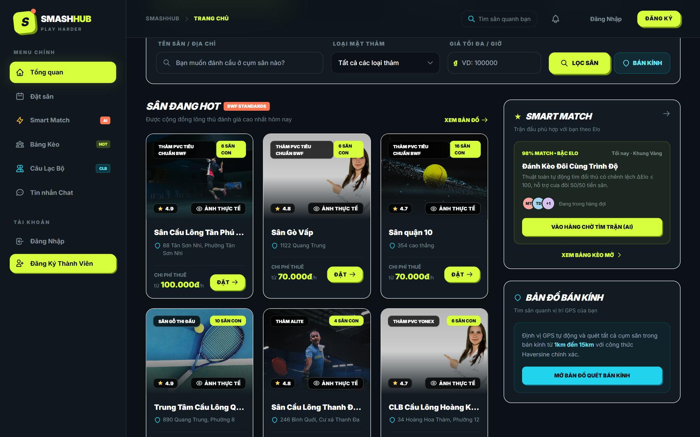
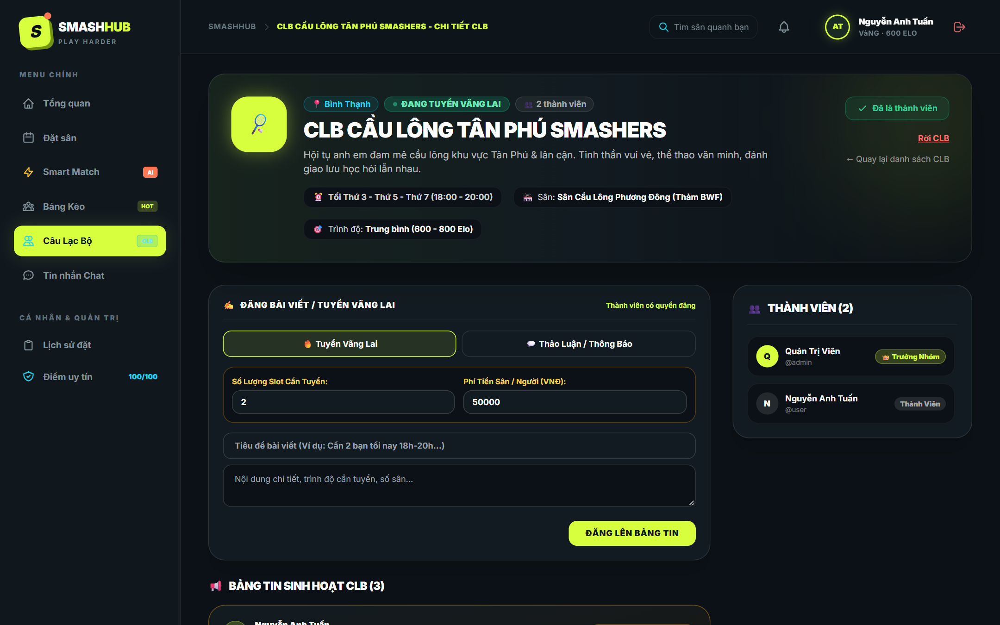
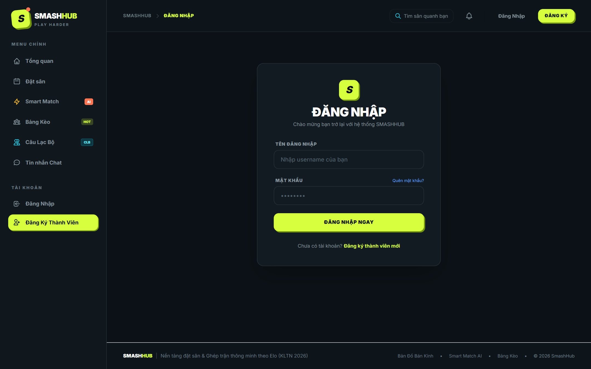
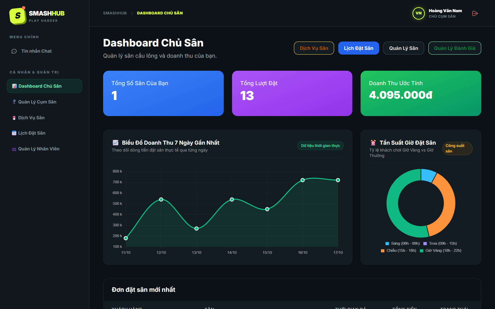

# 🏸 SMASHHUB - Nền Tảng Đặt Sân Cầu Lông & Ghép Trận AI (Smart Matchmaking)

[](https://www.php.net/)
[](https://www.mysql.com/)
[](https://tailwindcss.com/)
[](LICENSE)

**SMASHHUB** là hệ thống quản lý đặt sân cầu lông và kết nối cộng đồng lông thủ toàn diện. Nền tảng tích hợp thuật toán **Ghép trận thông minh (Smart Match)** độc quyền theo trình độ Elo và bán kính định vị GPS, giải quyết triệt để bài toán thiếu người đánh, chênh lệch trình độ và bùng kèo (No-Show).

---

## 🌟 Tính Năng Nổi Bật

### 1. 🎯 Ghép Trận Thông Minh (Smart Matchmaking AI) & Chia Đôi Hóa Đơn (Split Bill 50/50)
* **2 Chế độ linh hoạt**: *"Nhờ Hệ Thống Đặt Hộ"* (tìm sân trống tự động) hoặc *"Tôi Đã Có Sân Sẵn"*.
* **Phòng ghép sân & Chia đôi 50/50**: Khi ghép trận thành công, hệ thống mở phòng chờ ghép sân. Host trả 50% và Joiner trả 50% tiền sân trong thời hạn **15 phút giữ chỗ tạm thời**. Sau 15 phút nếu một trong hai bên không hoàn tất xác nhận, phòng ghép sẽ tự động giải phóng để tiếp tục tìm đối thủ mới.
* **Đàm phán đổi sân (Switch Pitch)**: Cả hai bên có thể đề xuất chuyển sang cụm sân trung tâm tiện hơn cho cả hai dựa trên khoảng cách GPS và chấp thuận đổi sân theo thời gian thực (Zero-Reload AJAX).
* **Bản đồ Leaflet & GPS tương tác**: Định vị vị trí hiện tại hoặc tìm địa chỉ toàn quốc, tự động chọn sân gần nhất.
* **Cơ chế phân cấp ưu tiên vị trí rõ ràng**:
  * 🥇 **Ưu tiên 1**: Định vị GPS & Bán kính quét (quét sân thực tế trong $X$ km theo công thức Haversine).
  * 🥈 **Ưu tiên 2**: Lọc theo Quận/Huyện dự phòng khi không bật GPS.
* **Thuật toán cân trình theo Elo chuẩn (K-factor = 32)**: Tự động tính điểm kỳ vọng và cập nhật điểm Elo sau trận dựa trên kết quả thi đấu hai bên xác nhận hoặc do chủ sân làm trọng tài nhập kết quả.
* **Nhắn tin trực tiếp giữa hai cơ thủ (Chat Box)**: Trò chuyện và thông báo tự động (thông báo ghép trận, nhắc thanh toán 50%, chúc mừng nhận mã check-in) qua bảng tin nhắn nội bộ `messages`.

### 2. 🛡️ Hệ Thống Điểm Uy Tín Fair-Play & Cơ Chế Chống Bùng Kèo (No-Show)
* Điểm uy tín cơ bản: **100/100 PTS**.
* Cộng điểm thưởng Fair-Play khi hoàn tất trận đấu đúng hẹn (**+2 PTS**).
* **Quy chuẩn trừ điểm uy tín khi tự ý hủy kèo**:
  * 🟢 Hủy sớm (> 2 tiếng trước giờ đấu): Phạt nhẹ **-5 PTS**.
  * 🟡 Hủy cận giờ (1 - 2 tiếng trước giờ đấu): Phạt **-15 PTS**.
  * 🔴 Hủy sát giờ (< 1 tiếng trước giờ đấu): Phạt nặng **-25 PTS**.
* **Xử phạt bùng kèo (No-Show)**: Đối thủ vắng mặt bị chủ sân xác nhận sẽ bị trừ **-30 PTS Uy Tín**, phạt **-50 Điểm Elo** và tạm khóa tìm trận.
* **Lịch sử biến động uy tín (`reputation_logs`)**: Ghi chép minh bạch từng lần cộng/trừ điểm kèm lý do và mã trận/đơn đặt.
* Tự động cảnh báo và **khóa tính năng tìm trận** nếu điểm uy tín dưới 50 PTS.

### 3. 👥 Cộng Đồng Câu Lạc Bộ & Nhóm Cố Định (Badminton Clubs)
* **Thành lập & Quản lý CLB**: Tự tạo CLB cho nhóm bạn, thiết lập lịch đánh định kỳ (ví dụ: Tối 2-4-6 hoặc cuối tuần), chọn sân nhà và yêu cầu trình độ Elo.
* **Bảng tin nội bộ & Tuyển Vãng Lai**: Khi nhóm thiếu chân, Trưởng nhóm / thành viên đăng tin *"Tuyển X Slot Vãng Lai"* kèm phí chia tiền sân, người chơi tự do có thể vào xin slot giao lưu tức thì.
* **Danh sách thành viên**: Theo dõi danh sách lông thủ, cấp quyền Trưởng nhóm / Thành viên.

### 4. 🏟️ Phân Hệ Dành Cho Chủ Sân (Court Owner) & POS Bán Hàng Tại Quầy
* **Quản lý cụm sân**: Thêm/Sửa/Xóa sân, định vị GPS, tải ảnh sân, cấu hình số lượng sân con và giá theo giờ.
* **POS Bán Hàng & Đặt Sân Tại Quầy (Walk-in Booking)**: 
  * Tạo đơn nhanh tại quầy lễ tân cho khách vãng lai.
  * Tích hợp bán các mặt hàng dịch vụ phụ trợ: nước suối, Revive chanh muối, thuê vợt thi đấu, ống cầu Hải Yến S90...
  * Tự động cộng tiền dịch vụ vào tổng hóa đơn thanh toán tiền mặt/VietQR.
* **Biểu Đồ Trực Quan Doanh Thu & Công Suất (Chart.js Analytics)**: 
  * 📈 Biểu đồ Doanh thu 7 ngày gần nhất (Line Chart Gradient) cập nhật tự động theo thời gian thực.
  * ⏰ Biểu đồ Doughnut phân tích tỷ lệ đặt sân theo các khung giờ (Sáng, Trưa, Chiều, Giờ Vàng cao điểm 18h-22h).
* **Quản lý & Duyệt đánh giá sân (`reviews`)**: Xem và quản lý các đánh giá sao, nhận xét của khách hàng sau khi chơi xong.
* **Phân quyền nhân viên**: Tạo tài khoản thu ngân/lễ tân và gán vào cụm sân phụ trách cụ thể (`assigned_pitch_id`).
* **Xuất báo cáo doanh thu**: Xuất file CSV thống kê chi tiết theo đơn đặt.

### 5. 💳 Thanh Toán VietQR, Ưu Đãi Hạng Elo & Quy Chuẩn Đặt Sân
* **Tự động sinh mã VietQR**: Mã QR ngân hàng động kèm mã đơn `CKIN...` và số tiền chính xác sau khi áp dụng giảm giá Rank Elo.
* **Ưu đãi theo Hạng Elo (Elo-based Promotions)**:
  * 💎 **Hạng Kim Cương** (Elo $\ge$ 1000): Giảm ngay **20%** tiền sân.
  * 🥇 **Hạng Vàng** (Elo $\ge$ 600): Giảm ngay **10%** tiền sân.
  * 🥈 **Hạng Bạc** (Elo $\ge$ 300): Giảm ngay **5%** tiền sân.
  * 🥉 **Hạng Đồng**: Giá niêm yết chuẩn.
* **Nút Mô Phỏng Thanh Toán (Sandbox Demo Mode)**: Cho phép chuyển trạng thái đơn đặt từ `unpaid` sang `paid` và xác nhận lịch tức thì trên giao diện mà không cần chờ tài khoản ngân hàng thật, tối ưu cho buổi demo bảo vệ đồ án.
* **Quy chuẩn thời gian đặt sân & check-in**:
  * ⏱️ Đặt trước tối thiểu **60 phút** so với giờ thi đấu để sân kịp chuẩn bị.
  * ⏱️ Khách chỉ được phép check-in sớm tối đa **15 phút** so với giờ bắt đầu ca đặt.
* **Bảo đảm toàn vẹn giao dịch (ACID & Concurrency Safe)**: Bọc toàn bộ quá trình kiểm tra trùng lịch và tạo đơn vào **Database Transaction** kết hợp khóa `SELECT ... FOR UPDATE`, giải quyết triệt để lỗi tranh chấp đặt sân cùng thời điểm (Race Condition).

### 6. 🎟️ Phân Hệ Bàn Trực Tiếp Đón (Staff / Receptionist)
* Giao diện tối ưu hóa cho màn hình cảm ứng / máy tính bảng lễ tân.
* **Check-in 1-Click**: Tìm kiếm theo Mã Check-in (ví dụ: `CKIN...`), SĐT hoặc tên khách.
* Hỗ trợ check-in riêng biệt từng người (Host/Guest) trong đơn cáp kèo thông minh AI.
* Ràng buộc bảo mật: Nhân viên chỉ được phép check-in các đơn thuộc Cụm sân mình phụ trách.

### 7. 👑 Phân Hệ Quản Trị Hệ Thống (Super Admin)
* Thống kê toàn cảnh doanh thu, số lượng sân, người dùng trên toàn hệ thống.
* Quản lý & khóa/mở cụm sân, phân quyền vai trò người dùng (Admin, Owner, Staff, User).
* Cấp tài khoản Thu ngân trực tiếp cho các cụm sân trong hệ thống.

### 8. 🔐 Tài Khoản & Bảo Mật Người Dùng
* **Đăng nhập linh hoạt**: Đăng nhập bằng **Tên đăng nhập (Username)** HOẶC **Số điện thoại (Phone)** đã đăng ký.
* **Đặt lại mật khẩu**: Xác minh thông tin tài khoản hợp lệ, mật khẩu tối thiểu 6 ký tự kèm xác nhận mật khẩu an toàn.
* **Bảo vệ CSRF & XSS**: Token CSRF cho các tác vụ thay đổi trạng thái và mã hóa đầu ra giao diện.

---

## 📸 Hình Ảnh Giao Diện Hệ Thống (Báo Cáo Đồ Án)

> Toàn bộ ảnh chụp màn hình độ phân giải cao (Full HD, 1.5x Retina) phục vụ báo cáo đồ án được lưu trữ tại thư mục [`docs/screenshots/`](docs/screenshots/).

### 1. Trang Chủ & Hệ Thống Nhận Diện Thương Hiệu


### 2. Danh Sách Cụm Sân Tiêu Chuẩn BWF & Bộ Lọc Bán Kính GPS


### 3. Album Ảnh Thực Tế Sân Đấu Đa Góc Nhìn (Interactive Court Gallery)


### 4. Sơ Đồ Lưới Khung Giờ Trống (06:00–22:00) & Chọn Vị Trí Sân Con BWF


### 5. Ghép Trận Thông Minh AI (Smart Matchmaking) & Điểm Uy Tín Fair-Play


### 6. Thanh Toán Trực Tuyến VietQR & Mô Phỏng Giao Dịch Tức Thì (Sandbox Mode)


### 6. Cộng Đồng Câu Lạc Bộ & Bảng Tin Tuyển Giao Lưu Vãng Lai


### 7. Bàn Trực Lễ Tân & Check-in 1-Click (Phân Hệ Nhân Viên Sân)


### 8. Dashboard Chủ Sân & Biểu Đồ Phân Tích Doanh Thu / Khung Giờ (Chart.js)


### 9. Phân Hệ Quản Trị Hệ Thống Toàn Diện (Super Admin Panel)


### 10. Giao Diện Tương Thích Thiết Bị Di Động (Mobile Responsive)
<p align="center">
  
</p>

---

## 🛠️ Yêu Cầu Hệ Thống & Cài Đặt

### 1. Yêu Cầu Môi Trường
* **Web Server**: Apache hoặc Nginx (Hỗ trợ tốt trên WAMP, XAMPP, Laragon, Docker).
* **PHP**: Phiên bản 7.3 trở lên (Hỗ trợ PHP 8.x).
* **Database**: MySQL 5.7+ hoặc MariaDB 10.3+.
* **Extensions PHP**: `pdo`, `pdo_mysql`, `mbstring`.

### 2. Hướng Dẫn Cài Đặt Nhanh

#### Bước 1: Tải mã nguồn về thư mục Web Server
Đặt thư mục dự án vào thư mục gốc của Web Server:
* WAMP: `C:\wamp64\www\badminton` (hoặc `F:\wamp\www\badminton`)
* XAMPP: `C:\xampp\htdocs\badminton`

#### Bước 2: Khởi tạo Cơ sở dữ liệu
1. Mở **phpMyAdmin** (`http://localhost/phpmyadmin`).
2. Tạo cơ sở dữ liệu mới có tên: `badminton_booking` (Collation: `utf8mb4_unicode_ci`).
3. Chọn tab **Import** và tải lên file: `badminton_booking.sql`.

#### Bước 3: Cấu hình kết nối Database
Mở file `config/database.php` và điều chỉnh thông số nếu cần:
```php
private $host = "localhost";
private $db_name = "badminton_booking";
private $username = "root";
private $password = ""; // Mặc định trên WAMP/XAMPP là rỗng
```

#### Bước 4: Khởi chạy ứng dụng
Mở trình duyệt web và truy cập:
```
http://localhost/badminton/index.php
```

---

## 👥 Danh Sách Tài Khoản Demo

| Vai trò (Role) | Tên đăng nhập (Username) | Mật khẩu (Password) | Chức năng kiểm thử |
| :--- | :--- | :--- | :--- |
| **Quản Trị Viên (Admin)** | `admin` | `123456` | Dashboard hệ thống, quản lý người dùng, duyệt sân |
| **Chủ Sân (Owner)** | `chusan_demo` | `123456` | Quản lý sân, đặt tại quầy, quản lý thu ngân |
| **Chủ Sân Bình Thạnh** | `chusan1` | `123456` | Quản lý cụm sân Bình Thạnh, duyệt lịch, duyệt thu 50% |
| **Nhân Viên (Staff)** | `nhanvien_demo` | `123456` | Bàn trực lễ tân, kiểm tra mã check-in |
| **Thu Ngân (Staff)** | `thungan` | `123456` | Bàn lễ tân cụm sân Bình Thạnh, check-in 1-Click |
| **Khách Hàng (User)** | `khach_alpha` | `123456` | Đặt sân trực tuyến, lập lệnh Smart Match AI |
| **Khách Hàng (User)** | `khach_beta` | `123456` | Đối thủ bắt cặp Smart Match AI, đàm phán đổi sân |
| **Khách Hàng (User)** | `user` | `123456` | Đặt sân và tham gia CLB |

---

## 🗄️ Cấu Trúc Cơ Sở Dữ Liệu (14 Bảng Chuẩn)

Hệ thống được thiết kế trên mô hình quan hệ chuẩn hóa gồm **14 bảng dữ liệu** trong tệp `badminton_booking.sql`:

1. `users`: Tài khoản người dùng, phân quyền RBAC (`admin`, `owner`, `staff`, `user`), tọa độ GPS, điểm uy tín và liên kết quản lý.
2. `pitches`: Cụm sân cầu lông, thông tin địa chỉ, tọa độ GPS, số lượng sân con BWF, loại thảm và giá thuê theo giờ.
3. `bookings`: Đơn đặt sân, mã check-in (`CKIN...`), số sân con (`court_number`), phương thức và trạng thái thanh toán.
4. `matchmaking`: Thông tin các trận cáp kèo, kết quả trận đấu, trạng thái thanh toán chia đôi và check-in của 2 bên.
5. `match_tickets`: Lệnh tìm trận Smart Match AI, bán kính quét GPS, thời hạn phòng ghép (`expires_at`), trạng thái xác nhận 50%.
6. `messages`: Hệ thống trò chuyện nội bộ và gửi thông báo tự động giữa các thành viên.
7. `notifications`: Thông báo hệ thống, thông báo kết quả duyệt đơn và biến động lịch thi đấu.
8. `reputation_logs`: Nhật ký biến động điểm Uy Tín Fair-Play (+2 khi hoàn thành, -5, -15, -25 khi hủy, -30 khi No-Show).
9. `reviews`: Đánh giá chất lượng cụm sân (số sao từ 1 - 5 và nhận xét) của khách hàng sau khi chơi.
10. `services`: Danh mục mặt hàng dịch vụ & tiện ích phụ trợ (nước suối, nước tăng lực Revive, thuê vợt, ống cầu Hải Yến).
11. `user_scores`: Điểm tích lũy và bảng xếp hạng Elo cá nhân theo từng mùa giải (`season`).
12. `clubs`: Danh sách các Câu Lạc Bộ cầu lông và nhóm sinh hoạt định kỳ.
13. `club_members`: Danh sách thành viên CLB kèm vai trò (`leader`, `admin`, `member`) và trạng thái duyệt.
14. `club_posts`: Bảng tin nội bộ CLB và tin tuyển slot giao lưu vãng lai kèm chi phí chia sẻ.

---

## 📁 Cấu Trúc Thư Mục Dự Án

```
badminton/
├── assets/                  # CSS, JS, hình ảnh tải lên
├── config/                  # Cấu hình kết nối cơ sở dữ liệu
│   └── database.php
├── controllers/             # Bộ điều khiển MVC (Admin, Owner, Staff, Booking, Matchmaking...)
├── models/                  # Các lớp thực thể (User, Pitch, Booking, MatchTicket, Reputation...)
├── views/                   # Giao diện người dùng
│   ├── admin/               # Màn hình quản trị
│   ├── owner/               # Màn hình chủ sân
│   ├── staff/               # Màn hình bàn trực thu ngân
│   ├── matchmaking/         # Màn hình tìm kèo Smart Match AI
│   ├── layout.php           # Khung layout chính
│   └── home.php             # Trang chủ
├── badminton_booking.sql    # File sao lưu cơ sở dữ liệu
├── index.php                # Router điều hướng chính
└── README.md                # Tài liệu dự án
```

---

## 📄 Bản Quyền
Dự án được phát triển phục vụ mục đích học tập, nghiên cứu và quản lý sân thể thao. Mọi đóng góp (Pull Request) đều được chào đón!
